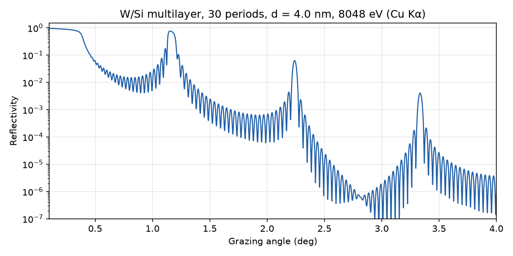

# grazing

grazing calculates, designs and fits X-ray thin-film coatings such as single layers, periodic and
depth-graded multilayer mirrors. You can use it as a desktop application, as a Python library, or
through a small command-line interface.

- **Calculate** the reflectivity of a coating as a function of grazing angle or photon energy.
- **Design** a coating that reflects as well as possible at given energies and angles, within
  manufacturing limits, and check how robust it is to layer errors (`grazing-design`).
- **Fit** measured X-ray reflectivity (XRR) to find the real structure of a coated sample, with
  uncertainties (`grazing-fit`).

Reflectivities come from the Parratt recursion, with Névot–Croce or Debye–Waller interface
roughness. Optical constants come from the atomic scattering factors of the Henke (CXRO) and
Chantler (NIST FFAST) tables and from [xraylib](https://github.com/tschoonj/xraylib), so the
energy range covers soft X-rays up to several hundred keV.



## Installation

grazing needs Python 3.12 or newer. Install it from a checkout of the repository:

```bash
git clone https://github.com/ckoern/grazing.git
cd grazing
pip install -e ".[gui]"
```

Leave out `[gui]` if you only need the library. Then start the applications with `grazing-design`
or `grazing-fit`.

## Example

Calculate the reflectivity of a W/Si multilayer with 30 periods of 4 nm at the Cu Kα energy:

```python
import numpy as np

from grazing.core.calc import reflectivity_vs_angle
from grazing.core.materials import get
from grazing.core.structure import Mirror, Periodic
from grazing.core.units import deg

W, Si = get("W"), get("Si")
mirror = Mirror(Periodic.create(W, Si, N=30, d=4.0, gamma=0.4, sigma_H=0.3, sigma_L=0.3), Si)

angles = deg(np.linspace(0.1, 4.0, 2000))
reflectivity = reflectivity_vs_angle(mirror, angles, energy=8048.0)
```

Lengths are in nm, energies in eV and angles in rad; `grazing.core.units` converts from other
units. `reflectivity_vs_energy` scans the energy at a fixed angle instead.

## Documentation and examples

- The user guide in [`docs/guide/`](docs/guide/index.md) has quick starts for designing and
  fitting, both in the applications and with Python, and topics on depth-graded coatings,
  tolerances, measured data and uncertainties.
- [`examples/`](examples/) contains runnable scripts, for example a reflectivity demo, the
  optimization of periodic and depth-graded mirrors and a fit of the synthetic measurements in
  `examples/data/`.
- The [physics background](docs/physics_background.md) describes the formalism, the optical
  constants and the references.

Build the full documentation, including the API reference, with:

```bash
pip install -e ".[docs]"
sphinx-build -b html docs docs/_build/html
```

## Development with LLMs

Most of the code, tests and documentation of grazing are written with LLM code generation, under
human direction and review. The reflectivity kernel is tested against analytic limits and
against reference data from CXRO, GenX and refnx (see the
[kernel verification](docs/kernel_verification.md)), but please review results critically and
report anything that looks wrong.

## License

See [LICENSE](LICENSE).
