# Design a mirror in xstack-design

This walkthrough designs a periodic W/B4C multilayer that reflects the Cu Kα line (8048 eV) at a
fixed grazing angle of 1.0°, for example as a monochromator in a laboratory diffractometer. The
target is a narrow band of ±1 % around the line. The same task is done with Python in
[Design a mirror with Python](quickstart_design_library.md).

Start the application with `xstack-design` (see [Installation](installation.md)). The window has
three areas:

- the **Candidates** dock on the left lists the input design and the designs that you store,
- the **workflow panel** in the middle has one tab per step, `1 Goal` to `10 Analyze`; you can work
  through them in order with the **Next** buttons or jump between them,
- the **plot tabs** on the right show the reflectivity, layers and results of the current step.

Every edit is an undoable step (**Edit > Undo**), and the *Journal* and *History* docks at the bottom
record what you did. Optimization results never overwrite your input design: they are stored as
*candidates* that you inspect, compare and promote when you want to.

## 1. Create the project

Choose **File > New…** (or the *New* toolbar button). The project wizard asks for the basics; all
choices can be changed afterwards.

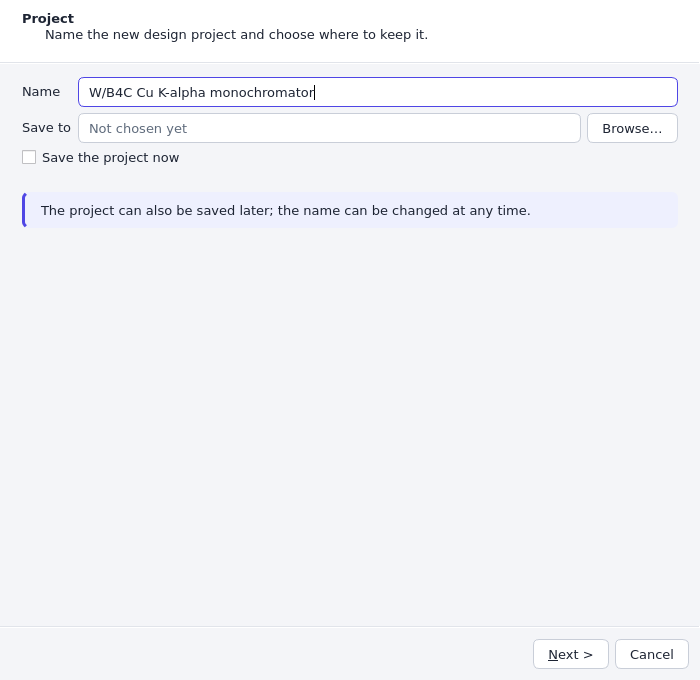

On the *Project* page, enter a name. Tick *Save the project now* and choose a file if you want the
project saved as a `.xstack` file immediately; otherwise it stays unsaved until you use
**File > Save**.

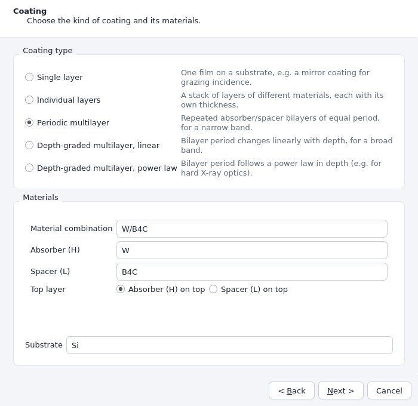

On the *Coating* page, select **Periodic multilayer**, the *Material combination* **W/B4C**
(absorber W, spacer B4C) and the substrate **Si**. The *Top layer* option decides which material
faces the beam; keep the default, absorber on top. The *Summary*
page lists your choices; **Create** builds the project.

The wizard creates the coating with sensible parameters, and the targets, figure of merit and
constraints of the periodic template, which you now adapt step by step.

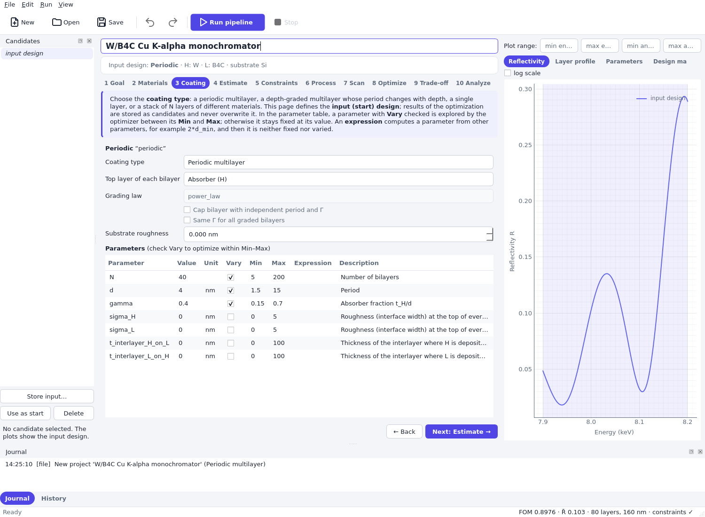

## 2. Goal: where the mirror shall reflect

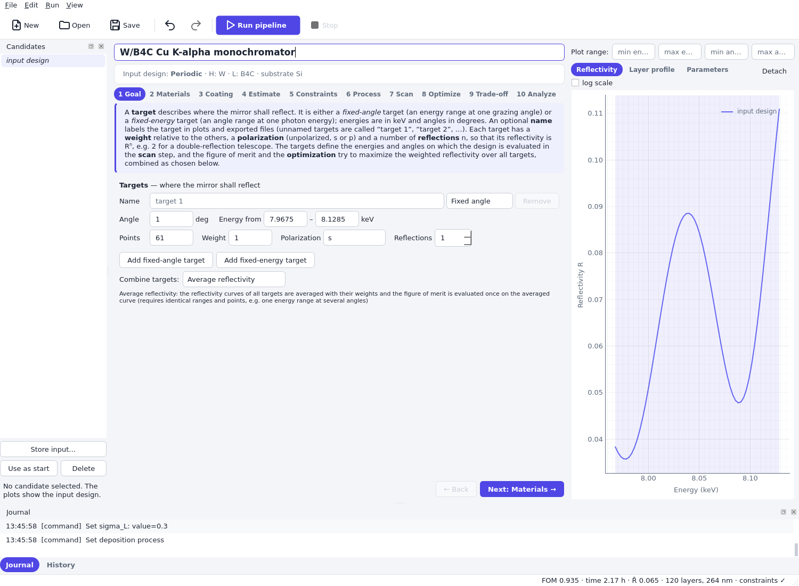

A **target** describes the energies and the angle at which the mirror shall reflect. Edit the
existing target:

- Scan type **Fixed angle** (an energy range at one grazing angle).
- *Angle* 1.0 deg, *Energy from* 7.9675 to 8.1285 keV (8.048 keV ± 1 %).
- *Points* 61, *Polarization* s.

What these choices mean:

- **The band sets the problem.** The figure of merit is evaluated only on the target range, so a
  narrow band asks for a narrow Bragg peak and a broad band for a broad response. The shaded area
  in the Reflectivity plot is the target range.
- **Points** is the number of grid points on which the reflectivity is evaluated. It must resolve the
  structure of the curve: a thick multilayer has sharp fringes, and too few points sample them
  randomly. A few tens of points are enough for a smooth Bragg peak.
- **Polarization**: *s* is the polarization perpendicular to the plane of incidence, appropriate for
  a mirror at a synchrotron beamline that reflects in the horizontal plane. For a laboratory
  X-ray tube use *unpolarized*. At 1° the difference is small, but it grows with the angle.
- **Weight**, **Reflections** and **Combine targets** matter with more than one target; see
  [Optimize for several targets](topics/design_multiple_targets.md).

The status bar at the bottom of the window shows the figure of merit (FOM), the mean reflectivity
R̄ and whether the constraints hold for the input design.

## 3. Materials

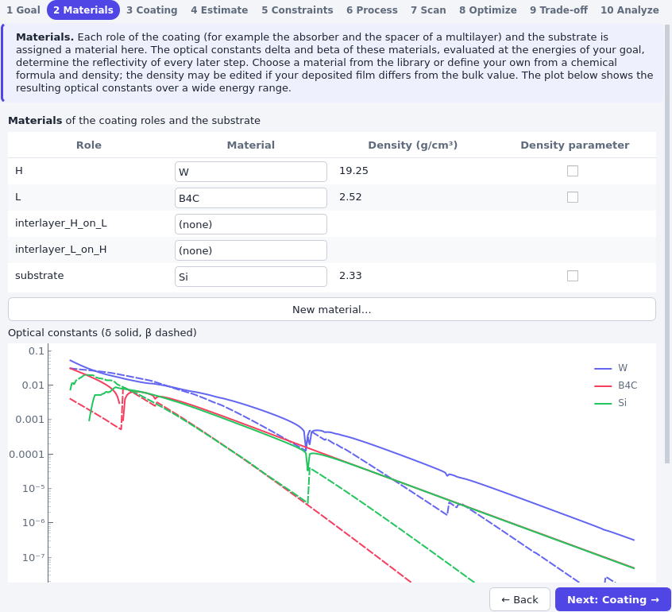

The table assigns a material to each coating role (H is the absorber, L the spacer) and to the
substrate. The optical constants δ and β are evaluated at the energies of your targets, and the
plot shows them over a wide energy range. The density is editable: a sputtered film is often less
dense than the bulk. If the density is different from the table value, change it here; the
reflectivity changes accordingly. **New material…** creates a material from a chemical formula and a
density.

The *contrast* between the two materials, δW − δB4C, determines how much
reflectivity each interface contributes, and β (the absorption) limits how many bilayers contribute.
W/B4C has high contrast and still low absorption for Cu Kα, hence its use. See
[optical constants](../physics_background.md) for the background.

The rows *interlayer_H_on_L* and *interlayer_L_on_H* describe layers that form at the interfaces
during deposition, for example a WSi₂ or W–C mixture. *(none)* means no interlayer. Choosing a material
adds an interlayer of that material between every pair of layers on that side; its thickness is the
parameter `t_interlayer_H_on_L` or `t_interlayer_L_on_H` on the **Coating** step (it starts at 0.5 nm)
and counts towards the period. Interlayers are part of the stack: they appear in the layer profile and
change the reflectivity. Keep them at *(none)* for this quick start.

## 4. Coating: the parameters

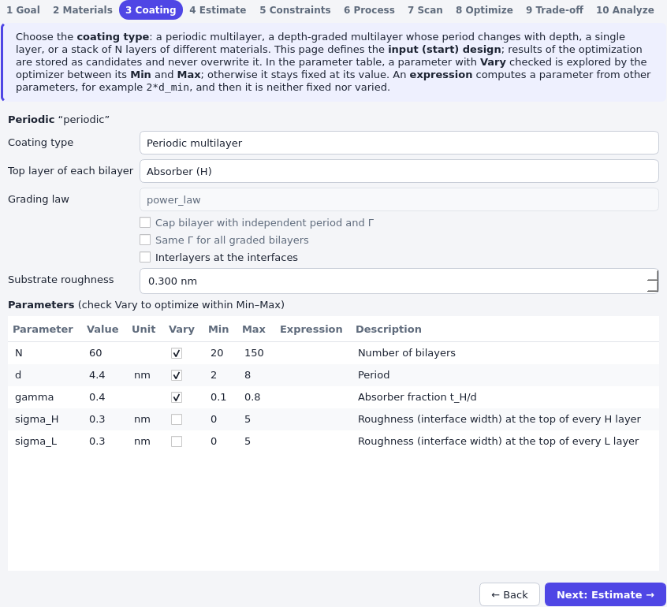

The *Coating type* and the *Top layer of each bilayer* come from the wizard. Set the *Substrate
roughness* to 0.3 nm. The **parameter table** defines the search space:

| Column | Meaning |
|---|---|
| Value | The current value. Fixed parameters keep it; for free parameters it is the start value. |
| Vary | Whether the optimizer may change the parameter. |
| Min, Max | The bounds of the search for a varied parameter. |
| Expression | Computes the parameter from other parameters (then it is neither fixed nor varied). |

For this task, vary `N`, `d` and `gamma` and set the values as in the figure: `N` 60 (20 to 150),
`d` 4.4 nm (2 to 8 nm), `gamma` 0.4 (0.1 to 0.8). Fix the roughness `sigma_H` and `sigma_L` at
0.3 nm (unchecked *Vary*): the optimizer cannot improve the roughness of your deposition process, so
it has to be an input, taken from a measurement of a real coating, for example with
[xstack-fit](quickstart_fit_gui.md).

Implications:

- **Bounds are a promise.** The optimizer never leaves them. Wide bounds make the search slower and
  leave more local optima; bounds that exclude the best design silently give a worse one. The
  period `d` is the parameter that must be right to within the bandwidth, so its bounds are
  worth narrowing. The *Estimate* step does it for you.
- **N is an integer** that is explored by the scan and global stages (not by the local refinement).
- **gamma (Γ)** is the fraction of the period that is absorber, tW/d. Low Γ means thin
  W layers, which absorb less; high Γ increases the reflectivity per bilayer until the absorption
  dominates (see [Γ](../physics_background.md)).

## 5. Estimate: analytic start values

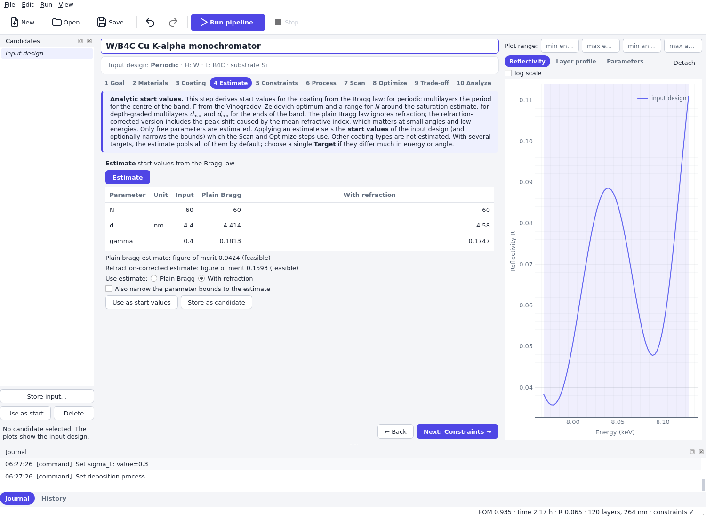

Press **Estimate**. The table lists, for each free parameter, your *Input* value and the values
from the plain Bragg law and from the refraction-corrected Bragg law. Each estimate is evaluated, so
you see its figure of merit and whether it is feasible.

- The period follows from the Bragg law for the centre of the band. The refraction-corrected
  estimate is larger because refraction shifts the Bragg peak to higher angles (lower energies) at a
  grazing angle of 1°; the plain estimate would miss the band by several bandwidths. That is
  visible in the two figures of merit.
- Γ is set to the Vinogradov–Zeldovich optimum, moved into the window that the minimum layer
  thickness constraint permits. The optimum for W/B4C is a very thin W layer, which the
  0.8 nm limit rules out.
- `N` is limited to a range around the saturation estimate.

**Use estimate** chooses between the two estimates, **Use as start values** applies it to the input
design, and *Also narrow the parameter bounds to the estimate* additionally sets the bounds to the
bounds of the estimate (otherwise they are only widened where the estimate lies outside them).
**Store as candidate** keeps the estimate without changing the input. For a multilayer problem the
estimate is usually already a good design; the optimization polishes it. Applying it is
optional: the first stage of the pipeline, `outline`, repeats it.

## 6. Constraints: what can be manufactured

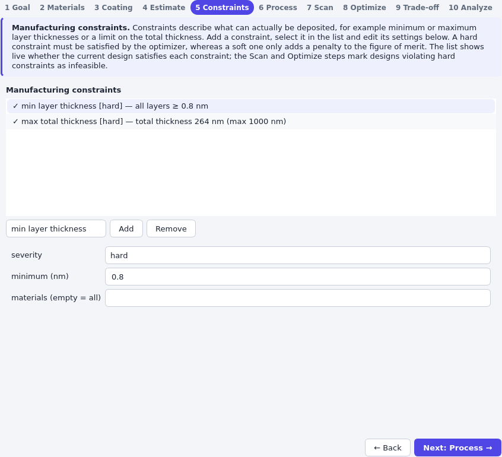

The list shows the constraints of the project with a live status for the input design (a check mark
means satisfied). Select a constraint to edit it below, and add a new one with the type selector and
**Add**. The periodic template contains *min layer thickness* of 0.8 nm and *max total thickness* of
1000 nm.

- A **hard** constraint must hold: the optimizer treats designs that violate it as infeasible and
  adds a large penalty, so every feasible design beats every infeasible one. A **soft** constraint
  only adds a penalty to the figure of merit, in proportion to the violation, so it can be traded
  against reflectivity.
- The **minimum layer thickness** matters most. Layers thinner than about 1 nm do not form
  continuous films (they are islands, not layers), so a design with a 0.5 nm tungsten layer cannot be
  made as calculated. The optimum of W/B4C is exactly such a design: Γ near 0.1 at a period of
  4.6 nm is a 0.4 nm tungsten layer. The constraint pushes Γ to larger values, at some cost in
  reflectivity, and you will see the consequence in the design map below.
- *max total thickness* limits stress and deposition time; *max layers* limits the number of layers;
  *max coating time* needs the deposition process of the next step.

## 7. Process: how long coating takes (optional)

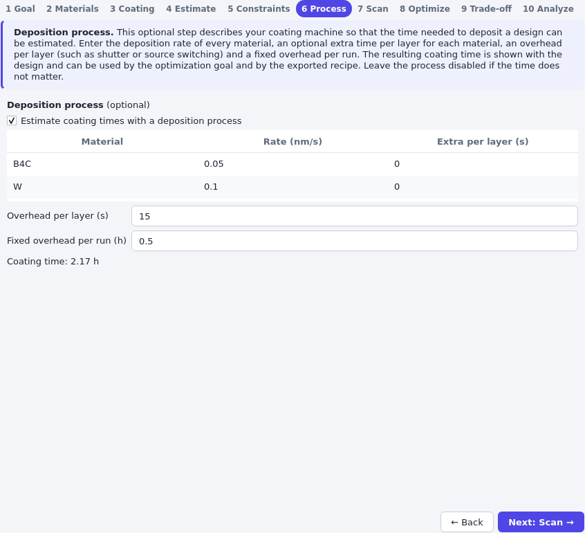

Enable the process to estimate the coating time of every design. Enter the deposition rate in nm/s
for each material (W 0.1 nm/s, B4C 0.05 nm/s here), an extra time per layer for each material, an
*overhead per layer* in s (shutter or target switching) and a *fixed overhead per run* in h
(pump-down, warm-up). The coating time is shown below the table and in the status bar.

The coating time is not needed for the optimization, but it appears in the candidate details, enters
the recipe export and enables the time penalty and trade-off of
[depth-graded mirrors](topics/design_depth_graded.md). Leave the process disabled if time
does not matter. See [manufacturing aspects](../physics_background.md) for the formula.

## 8. Scan: look at the design space

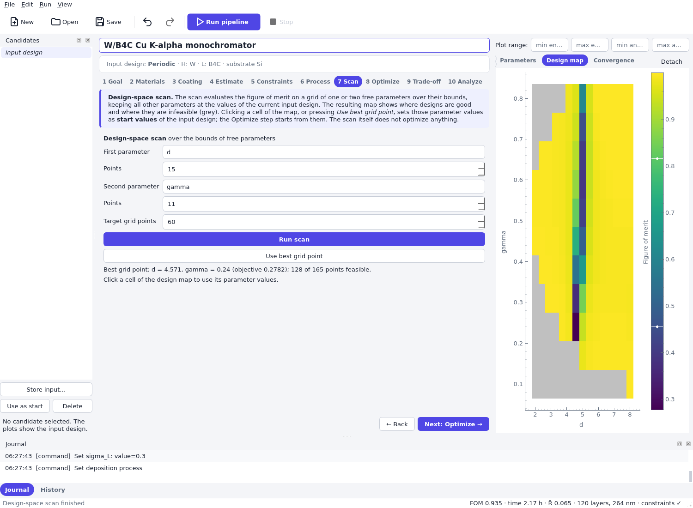

The scan evaluates the figure of merit on a grid of one or two free parameters over their bounds,
keeping the others at their current values. Choose *d* as the first parameter and *gamma* as the
second, and press **Run scan**. The result appears in the *Design map* tab.

- The colour is the figure of merit (lower is better, and 1 − ⟨R⟩ for the mean reflectivity), and
  grey cells are infeasible. Here the grey regions are caused by the layer-thickness constraint:
  at high Γ and small d the B4C layer is thinner than 0.8 nm, and at low Γ the W layer is.
- The dark vertical stripe is the Bragg peak: the figure of merit is good only if the period is
  within a fraction of a percent of the right value. This is why the *period* has to be known well
  and why a fixed-angle monochromator is sensitive to manufacturing errors of `d`.
- The scan optimizes nothing. **Use best grid point** or a click on a cell sets those values as the
  start values of the input design.

The map confirms that the problem has a clear optimum, and shows which of the constraints shapes it.
Scans are cheap and give an overview before and after a numerical search.

## 9. Optimize: run the pipeline

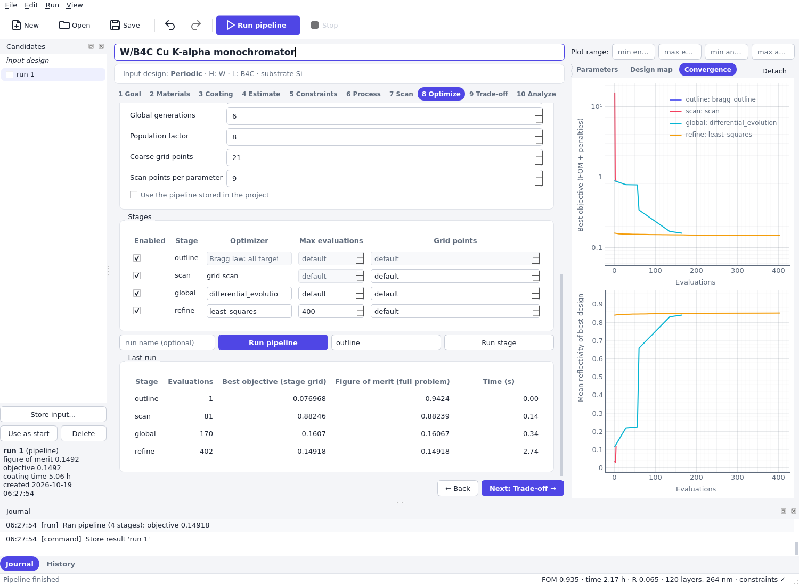

The **Optimize** step defines the *figure of merit* and the *pipeline* that minimizes it.

**Figure of merit.** *Mean reflectivity* rates the design by the average reflectivity over the
target band (the value is 1 − ⟨R⟩). It rewards a high average over the whole band, so a mirror with a
broad, medium-height peak can beat one with a high, narrow peak that covers only part of the band.
The other choices are described on the page: *soft min reflectivity* lifts the weakest part of the
band, *profile deviation* matches a prescribed shape, *flatness* rates the variation of R (and does
not reward a high reflectivity on its own), and *peak reflectivity* only rates the highest point of
the band. You can combine two of them with a fraction f, and penalize the coating time (see
[depth-graded mirrors](topics/design_depth_graded.md)).

**Pipeline stages.** The default pipeline has four stages. Each starts from the best design so far,
so the result is never worse than the input design.

| Stage | What it does | Why |
|---|---|---|
| outline | Bragg-law estimate (the Estimate step) | Good start values and narrower bounds without any search. |
| scan | Grid over Γ and `N` on a coarse grid | Finds the right region for the parameters that make the problem multimodal. |
| global | Differential evolution over all free parameters on a coarse grid | Escapes local optima; needs many evaluations. |
| refine | Local least-squares refinement on the full grid | Converges to the exact optimum within the basin. |

**Pipeline settings.** The *Random seed* makes the global stage reproducible (leave it empty for a
different run each time). *Global generations* and *Population factor* set the budget of the global
search, *Coarse grid points* the grid of the scan and global stages, and *Scan points per
parameter* the grid of the scan stage. For real designs keep the defaults (30 generations,
population 10); for a first try reduce them. In the *Stages* table you can disable stages, change the
local method, and cap the *Max evaluations* of a stage; the figure uses 400 evaluations for `refine`
to keep the run short. Use a **global** stage when the landscape has many peaks (many bilayers,
several free parameters) and only a local stage when you start close to a design you trust, for
example one that you promoted from an earlier run.

Press **Run pipeline** (or the toolbar button). The progress bar shows the evaluations, the
*Convergence* tab shows the best objective and the mean reflectivity of the best design against the
evaluations, one colour per stage, and the *Reflectivity* tab draws the best design so far. *Stop*
cancels the run and keeps the best result so far. The *Last run* table lists the stages. The
objective of the first stage is not comparable with the others: it is computed with an approximate
kinematic model, and the scan and global stages use the coarse grid. The right column,
*Figure of merit (full problem)*, evaluates every stage result in the same way.

## 10. Inspect the result

The run stores its final design as the candidate `run 1`, which is selected. Click an entry in the
Candidates dock to select it, check its box to overlay it, double-click to rename it.

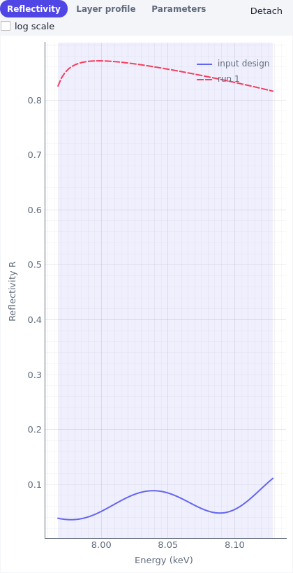

The *Reflectivity* tab shows the input design (solid) and the selected candidate (dashed). The
*Parameters* tab compares the parameters:

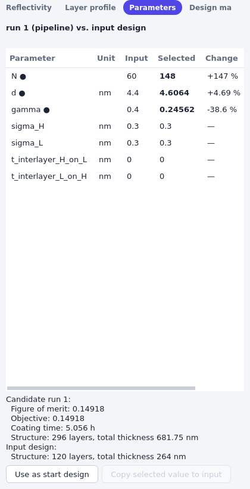

and the *Layer profile* tab shows the thickness of every layer and, for bilayers, the period d and
Γ per bilayer:

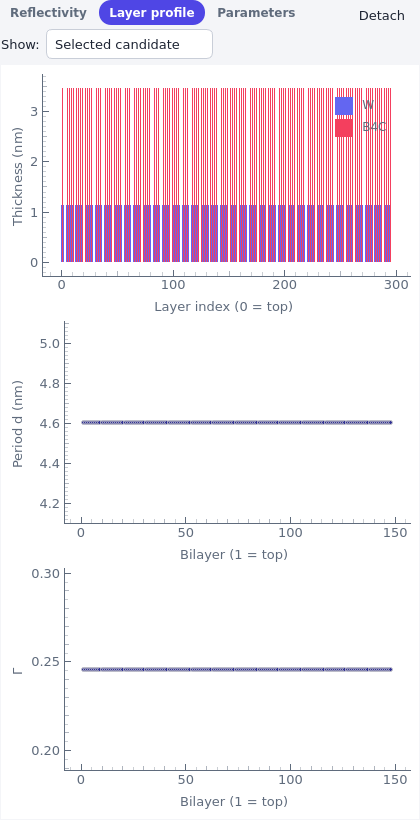

Compare the result with what you expect.

- The optimized Γ is above the analytic optimum because of the 0.8 nm limit on the W layers, and
  the thickness of the W layer in the *Layer profile* tab is at least that. A design that sits exactly
  at a constraint limit is normal: the constraint is active. Relaxing it (if your process allows)
  would improve the reflectivity, which tells you what the constraint costs.
- In the figure, the optimizer found N = 148 bilayers with a coating time of 5.1 h, while the
  [library example](quickstart_design_library.md) found N = 53 (2.1 h) with practically the same mean
  reflectivity; your numbers will differ with the seed and the budget. The reason is that the number of
  bilayers `N` saturates: beyond some N the added bilayers absorb as much as they
  reflect. The optimizer may choose a larger N than necessary because the mean reflectivity
  rewards even a tiny improvement while the coating time is not part of this objective. Compare
  the coating time of the candidate in the details below the list with that of a design with fewer
  bilayers; the time penalty of [depth-graded mirrors](topics/design_depth_graded.md) addresses
  exactly this.
- The details of the candidate show the figure of merit, the objective (the same unless a
  constraint is violated), the coating time and the creation time.

**Use as start** copies the candidate into the input design, for example to refine it further with
another run. **Store input…** stores the current input design under a name. The *Export
reflectivity…* entry of the candidate context menu (right click) writes the reflectivity curves as a
CSV file.

## 11. Analyze: how robust is the design?

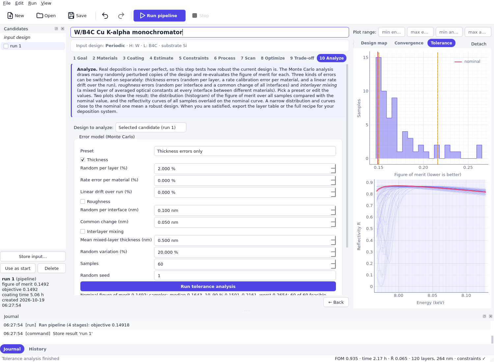

Select *Selected candidate* in *Design to analyze*, choose the error model *Thickness errors only* and
press **Run tolerance analysis**. The analysis draws random manufacturing errors, evaluates the
figure of merit of each perturbed design and shows the result in the *Tolerance* tab: the
histogram of the figure of merit over the samples with the nominal value (red line) and the 10 % and
90 % percentiles (dashed lines), and the reflectivity of all samples overlaid on the nominal curve.

How to read it:

- A narrow histogram next to the nominal value means that the design tolerates the errors. A long
  tail to the right (worse figure of merit) means that some coatings fail.
- The figure of merit is *lower for better mirrors*, so the 90th percentile is the pessimistic end:
  nine out of ten coatings are at least that good.
- The summary under the button lists the nominal value, the median, the 10 to 90 % range, the worst
  sample and how many samples satisfy the constraints.

Random thickness errors of a few per cent average out over many layers, but errors that act on
all layers at once (a rate calibration error or drift) shift the period of the whole stack and with
it the Bragg peak. Switch on the *Rate error per material* to see the effect on this narrow-band
mirror. All error types are explained in
[Tolerances, process and recipe](topics/design_tolerances.md).

## 12. Export the recipe and save the project

The *Deposition recipe* box on the Analyze page writes the layer table of the analyzed design:

- **Export layer table (CSV)…** has one row per layer in deposition order (row 1 on the substrate)
  with material, thickness in nm, roughness and, if a process is defined, the duration and start time
  of every layer.
- **Export recipe (JSON)…** contains the same table together with the substrate, the total
  thickness and the total coating time.

The recipe uses the *nominal* thicknesses and the rates of your process definition. Calibrate your
deposition system against a witness sample before you rely on it.

Save the project with **File > Save**. The `.xstack` file contains the input design, the
candidates, the targets, the figure of merit, the constraints, the process and the journal, and
opens again in `xstack-design` or from the library with
`Project.load("monochromator.xstack")` (see
[Design a mirror with Python](quickstart_design_library.md)).

## Where to go next

- [Optimize for several targets](topics/design_multiple_targets.md): one coating for several angles
  or energy bands.
- [Depth-graded supermirrors and the coating time](topics/design_depth_graded.md): broadband
  mirrors and the trade-off between reflectivity and time.
- [Tolerances, process and recipe](topics/design_tolerances.md).
