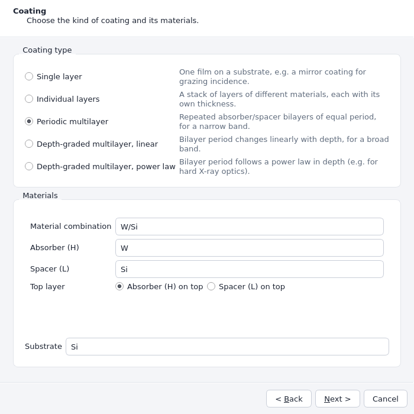
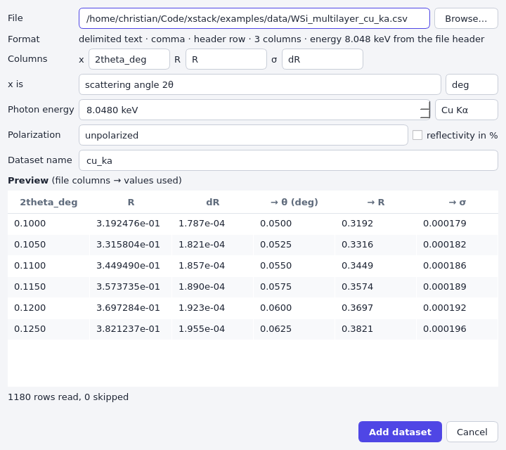
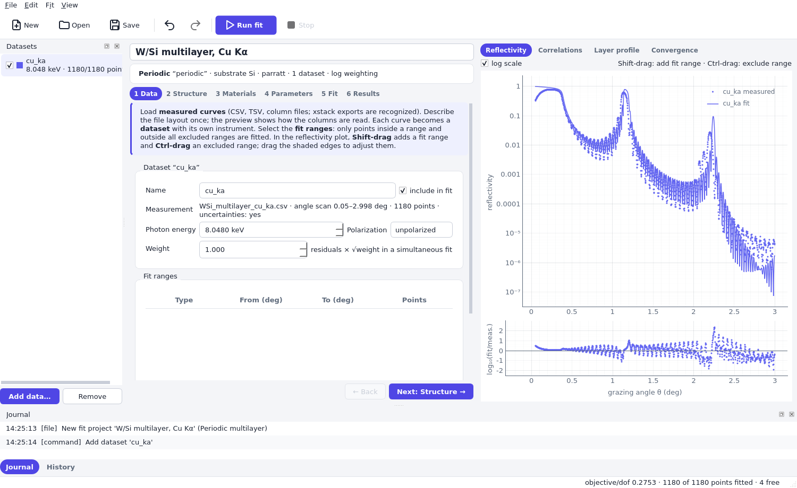
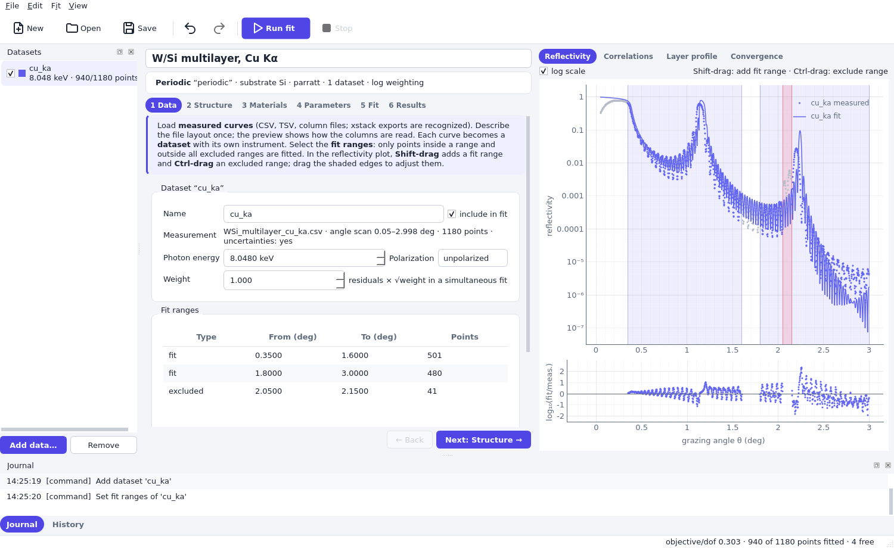
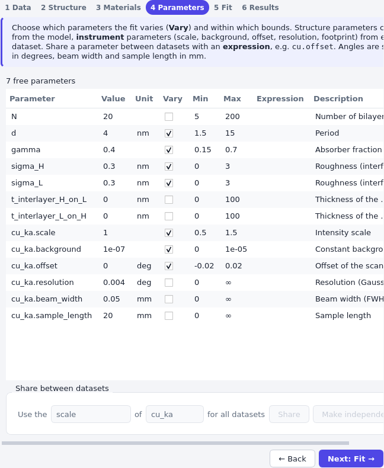
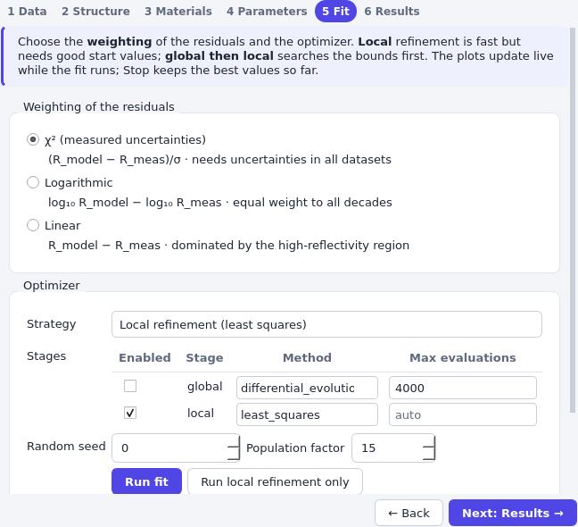
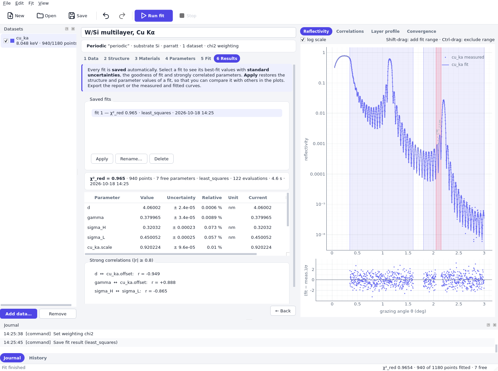
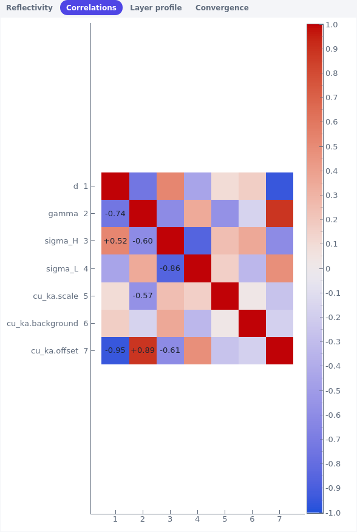

# Fit a measurement in xstack-fit

This quick start determines the structure of a coated sample from a measured reflectivity curve.
The example is a W/Si multilayer with 20 bilayers on a silicon substrate, measured in a θ/2θ scan
with Cu Kα radiation (8048 eV). The measurement is the file `examples/data/WSi_multilayer_cu_ka.csv`
of the repository. It is synthetic, so its header lists the true parameters and you can check that
the fit recovers them. The same fit with Python is described in
[Fit a measurement with Python](quickstart_fit_library.md).

You will

1. create a project with a W/Si multilayer as start structure,
2. import the measured curve,
3. choose which points are fitted,
4. choose which parameters are varied,
5. run the fit and
6. read the results and save the project.

Start the application with `xstack-fit` (see [Installation](installation.md)).

## 1. Create the project

Choose **File > New…**. The project wizard asks for the project name and, optionally, a file to
save to. On the second page choose the coating type *Periodic multilayer*, the material combination
*W/Si*, and keep *Absorber (H) on top* and the substrate *Si*. *Create* opens the project.



The wizard only provides a start structure. A fit needs a model that is close enough to the real
sample that the optimizer can find the minimum, and every value can be changed afterwards on the
**Structure**, **Materials** and **Parameters** pages. The wizard prepares
the structure for fitting: the period d and the absorber fraction Γ are free within generous bounds
(which you can still adjust on the Parameters page), the interface roughnesses `sigma_H` and
`sigma_L` are free between 0 and 3 nm starting at 0.3 nm, and integer parameters such as the
number of bilayers N are fixed.

```{note}
*File > New from template* offers ready-made fit projects whose roughnesses are already free, and
*Structure > Start structure* can import the design from an `.xstack` file made with xstack-design.
The reflectivity model (**Structure > Reflectivity model**) is the exact Parratt calculation with
Névot–Croce roughness by default; it is the right choice for this example.
```

## 2. Import the measured data

Choose **File > Add data…** (Ctrl+D), or press *Add data…* in the *Datasets* dock. In the import
dialog choose the file `examples/data/WSi_multilayer_cu_ka.csv` with *Browse…*, or drop it on the
dialog.



xstack reads the file whenever an entry changes, and the preview shows the file columns next to
the values that will be used: the angle converted to the grazing angle θ in degrees, the
reflectivity and the uncertainty. Check that these are what you expect before you add the data.
For this file the dialog proposes the right layout:

- **Columns** `2theta_deg`, `R` and `dR` are the scanned variable, the reflectivity and its
  uncertainty. The header row gives the names; a file without header offers *column 1*, *column 2*,
  … instead. Choose *(none)* for σ if the file has no uncertainties.
- **x is** *scattering angle 2θ* in *deg*. This is the angle between the incident beam and the
  detector direction, twice the grazing angle on the sample. xstack always works with the grazing
  angle θ, so it divides the values by two when it reads them. Entering 2θ as θ would stretch the
  curve by a factor of two, so the structure found by a fit would be wrong.
- **Photon energy** 8.0480 keV. The comment lines of the file state the energy
  (`# Photon energy: 8.0480 keV`), and the dialog takes it over; the format line says so. If a file
  does not state it, set the energy yourself or choose one of the presets (Cu Kα, Mo Kα, Ag Kα).
  The energy fixes the optical constants of the materials, so an error of a few percent shifts the
  fitted thicknesses by about the same fraction.
- **Polarization** *unpolarized* and *reflectivity in %* unchecked.
- **Dataset name** `cu_ka`. The name is also the prefix of the instrument parameters
  (`cu_ka.scale`, …), so a short name keeps the Parameters page readable. The dialog proposes the
  file name.

*Add dataset* adds the curve. The plot shows the measured points and, as a line, the reflectivity
that the start structure gives for them. The start structure does not match yet, which the fit
will change.



The measured data keep all points. Which of them are fitted is a separate selection, made on the
**Data** page.

## 3. Choose the fit ranges

The fit uses points inside a *fit range* and outside every *excluded range*; without any fit range,
all points outside the excluded ranges are used. Ranges are given in the grazing angle θ in degrees
(the plot axis), even though the file holds 2θ. Fitted points are coloured, the others grey.

There are two ways to set ranges. In the plot, **Shift-drag** adds a fit range and **Ctrl-drag**
an excluded range; shaded ranges can be moved and resized by dragging their body or edges.
Alternatively, press *Add fit range* or *Add excluded range* on the Data page and type the limits
in the table, where each row also shows the number of points in it.

For this measurement:

- Fit range θ = 0.35° to 1.6° and a second fit range 1.8° to 3.0°. The total reflection region
  below 0.35° is left out. The reflectivity there is close to 1 and depends mainly on the
  footprint of the beam on the sample, the scale and the exact alignment, which you would have to
  model well to use it. Often the region below the critical angle is excluded so that these
  details do not bias the structure, at the price of losing the information they carry. The
  gap between 1.6° and 1.8° has no special meaning here and only illustrates how several ranges
  are combined.
- Excluded range θ = 2.05° to 2.15°. The comment lines of the file say that the detector shows an
  artifact at 2θ = 4.12° to 4.28°, that is θ = 2.06° to 2.14°. A few outliers would otherwise be
  fitted like regular points and, with a χ² weighting, they weigh heavily.



The status bar and the *Datasets* dock show how many points are fitted (940 of 1180). A fit range
is the better tool for large regions you do not trust, an excluded range for isolated outliers.
[Fit ranges and weighting](topics/fit_ranges_and_weighting.md) discusses how to choose them.

## 4. Check the structure and materials

The **Structure** page shows the coating type and its options, and the **Materials** page lists
the optical constants of the materials. For this example nothing needs to change. When you fit a
different sample, this is where you would edit the layers and materials.

## 5. Set the parameters

The **Parameters** page lists all parameters of the fit: first those of the structure, then the
instrument parameters of each dataset as `<dataset>.<parameter>`. *Vary* lets the optimizer change a
parameter within *Min* and *Max*; all other parameters keep their *Value*. Angles are shown in
degrees and the beam width and the sample length in millimetres. Edit a cell by double-clicking it.



The wizard has already set the structure parameters. Change only `N` (to 20) and enter the
instrument parameters (the last rows of the table):

| Parameter | Value | Vary | Min / Max | Why |
|---|---|---|---|---|
| `N` | 20 | no | | The number of bilayers is known from the deposition. Set the value; the wizard keeps it fixed (integer parameters are only varied by global search methods). |
| `d` | 4.0 nm | yes | 1.5 / 15 | The period; only a rough start value is needed (from the wizard). |
| `gamma` | 0.4 | yes | 0.15 / 0.7 | The fraction of absorber in the period (from the wizard). |
| `sigma_H`, `sigma_L` | 0.3 nm | yes | 0 / 3 | The roughness of the interfaces of W on Si and Si on W (from the wizard). |
| `cu_ka.scale` | 1.0 | yes | 0.5 / 1.5 | Factor between the true and the measured intensity. |
| `cu_ka.background` | 1e-7 | yes | 0 / 1e-5 | Constant background, for example from stray light. |
| `cu_ka.offset` | 0 deg | yes | −0.02 / 0.02 | Misalignment: true minus nominal grazing angle. |
| `cu_ka.resolution` | 0.004 deg | no | | Gaussian angular resolution σ, known from the instrument. |
| `cu_ka.beam_width` | 0.05 mm | no | | FWHM of the beam, known from the setup. |
| `cu_ka.sample_length` | 20 mm | no | | Length of the sample along the beam. |

The interlayer thicknesses `t_interlayer_H_on_L` and `t_interlayer_L_on_H` stay fixed at zero. The
status bar shows the number of free parameters, here seven.

The choice of what to vary is the most important decision of a fit. Vary what is unknown and what
the data can determine, and fix what you know. Every free parameter that the data do not
determine makes the other uncertainties larger, and parameters that compensate each other make the
fit ambiguous. The page [Fit ranges and weighting](topics/fit_ranges_and_weighting.md#the-instrument-model)
explains when to free each instrument parameter, and in particular the resolution.

Choose limits that are physically plausible. They keep the optimizer from visiting absurd
structures, and a result that ends *at bound* in the results table tells you that the bound, not
the data, decided the value.

## 6. Run the fit

On the **Fit** page choose the weighting *χ² (measured uncertainties)*. The residual of each point
is (R_model − R_measured)/σ, so points with a small uncertainty weigh more. This is the statistically
correct choice if the uncertainties are trustworthy, as they are here, and it makes the reduced χ²
a measure of the quality of the fit. It needs uncertainties in all datasets. The other weightings,
*Logarithmic* and *Linear*, are discussed in
[Fit ranges and weighting](topics/fit_ranges_and_weighting.md#weighting).



The *Strategy* sets the optimizer stages:

- *Local refinement (least squares)* improves the start values step by step and is fast, a few
  seconds here. It finds the minimum nearest to the start values, so it needs start values close
  enough to the truth.
- *Global search, then local refinement* first explores the whole range between *Min* and *Max* of
  all free parameters with differential evolution (4000 evaluations by default, with a random seed
  and a population factor) and then refines the best point locally. It is slower, needs finite
  bounds, and is the choice when you do not know the structure well. See
  [Uncertainties and checking a fit](topics/uncertainties.md#local-minima-and-global-search).
- *Custom* lets you edit the stages table.

Here the start values are good, so use the local refinement. Press *Run fit* (Ctrl+R). While the fit
runs the plots update live, the **Convergence** tab shows the best objective against the number of
evaluations, and *Stop* (Ctrl+.) ends the fit and keeps the best values so far. *Run local
refinement only* (Ctrl+Shift+R) runs a least-squares refinement from the current values whatever
the strategy is.

## 7. Read the results

When the fit is finished it is saved as “fit 1” on the **Results** page, and its values are applied
to the project. The plot shows the fitted curve through the data. Below it the residuals,
(fit − meas.)/σ, scatter around zero without trend.



**Goodness of fit.** The summary line shows χ²_red = 0.965 for 940 points and 7 free parameters.
The reduced χ² is the sum of the squared residuals divided by the number of degrees of freedom,
the points minus the free parameters. If the model is right and the uncertainties describe the
noise, χ²_red is close to one: the data deviate from the model as much as their uncertainties say.
A value much larger than one means that the model or the start values are wrong (look at the
residuals for a pattern), or the uncertainties are too small. A value much smaller than one means
the uncertainties are too large or the model has too many free parameters. For the logarithmic and
linear weighting the page shows *objective/dof* instead, which has no absolute meaning.

**Values and uncertainties.** The table lists the value, the standard uncertainty, the relative
uncertainty, the unit, the *Current* value in the project and a *Note*. The synthetic data were
generated with the values in the last column:

| Parameter | Fit | True |
|---|---|---|
| `d` | 4.06002 ± 0.00002 nm | 4.06 nm |
| `gamma` | 0.37997 ± 0.00003 | 0.38 |
| `sigma_H` | 0.3203 ± 0.0002 nm | 0.32 nm |
| `sigma_L` | 0.4501 ± 0.0003 nm | 0.45 nm |
| `cu_ka.scale` | 0.92022 ± 0.00010 | 0.92 |
| `cu_ka.background` | (6 ± 4)·10⁻⁸ | 2·10⁻⁷ |
| `cu_ka.offset` | 0.005994 ± 0.000009 deg | 0.006 deg |

The fit recovers the structure. The uncertainties are statistical: they say how much the
parameters would scatter if the same measurement were repeated with the noise of the data, assuming
that the model is correct. The very small uncertainties here belong to a model that describes
the synthetic data perfectly, and real systematic errors (a wrong material density, a wrong energy,
the simplified roughness model) are usually larger. The background deviates from the true value by
three uncertainties, because it is small compared with the signal and because the example's
uncertainties are estimated from the observed counts, which biases points with few counts.

The *Note* column shows *at bound* if a value sits at its *Min* or *Max*, and *undetermined* if
the data do not determine the parameter. See [Uncertainties](topics/uncertainties.md).

**Correlations.** The group *Strong correlations (|r| ≥ 0.8)* lists parameter pairs whose
errors move together: the period d and the angle offset (r = −0.95), Γ and the angle offset
(+0.89), and the two roughnesses (−0.87). The **Correlations** tab of the plot area shows the
whole correlation matrix of the selected fit.



A strong correlation means that two parameters can compensate for each other. Here, a different
angle offset shifts all the peaks of the curve, as does a different period, and only the
details of the curve (and the data over a wide angular range) tell them apart. Their
uncertainties are already enlarged by the correlation. When the correlation is close to ±1 and
the fit fails to determine both, consider fixing the parameter that you know better, for
example the offset from a separate alignment scan. Do not read the single uncertainties of
strongly correlated parameters on their own.

**Saved fits.** Every fit run is added to *Saved fits* with its goodness of fit, method and time.
Select a fit to show its values, *Apply* it to restore its structure and parameter values in the
project (the plot then shows that fit), *Rename…* it (also by double-click or F2) or *Delete* it.
Saved fits let you try other weightings, ranges, or start values and compare the results; see
[Uncertainties](topics/uncertainties.md#comparing-saved-fits).

**Export.** *Copy report* and *Export report…* write the text report of the selected fit (method,
χ²_red, the parameter table with uncertainties and the strong correlations). *Export curves
(CSV)…* writes the measured and the modeled curve of every dataset, with the columns `dataset`,
`axis`, `x` (deg or keV), `x_unit`, `measured`, `uncertainty`, `model` and `fitted` (1 for fitted
points). The curves are those of the values that are currently applied in the project, so apply
the fit that you want to export first.

## 8. Save the project

*File > Save* (Ctrl+S) writes the project as an `.xfit` file. It contains the measured data, the
structure and all settings, the saved fits, and the journal of all changes, so a later session
continues where you stopped. All edits can be undone (*Edit > Undo*, or the *History* dock).

The command-line tools use the same files:

```{code-block} bash
xstack fit info project.xfit                  # data, ranges, parameters, last result
xstack fit run project.xfit --output fitted.xfit
xstack fit export project.xfit curves.csv     # measured and modeled curves
```

## Where to go next

- [Fit a measurement with Python](quickstart_fit_library.md): the same fit as a script.
- [Measured data](topics/measured_data.md): file layouts, units, percent, decimal commas and more.
- [Fit ranges and weighting](topics/fit_ranges_and_weighting.md): choosing ranges, weighting and
  instrument parameters.
- [Fitting several datasets together](topics/fit_simultaneous.md): Cu Kα and Mo Kα in one fit.
- [Uncertainties and checking a fit](topics/uncertainties.md): how to judge a result.
