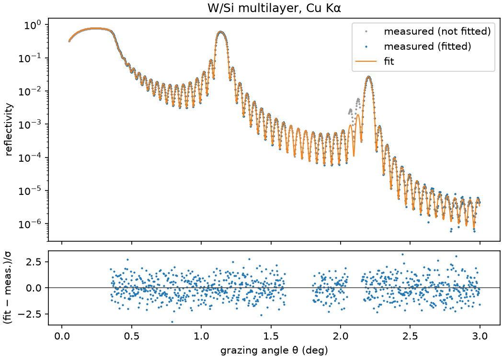

# Fit a measurement with Python

This page fits the same measurement as [the GUI quick start](quickstart_fit_gui.md) with the
Python library: the θ/2θ scan `examples/data/WSi_multilayer_cu_ka.csv` of a W/Si multilayer with
20 bilayers, measured with Cu Kα radiation (8048 eV). The header of the file lists the true
parameters. A complete script with a global search is `examples/fit_reflectivity.py`.

Every snippet on this page runs in order in one Python session, in a few seconds.

## The model of a fit

A fit compares one structure model with one or more measured curves. Its parts are

- a {py:class}`~xstack.core.measurement.MeasuredCurve`, the data, read from a file;
- a {py:class}`~xstack.core.structure.coating.Mirror` whose *free* parameters are fitted;
- a {py:class}`~xstack.fit.dataset.Dataset` per curve, which adds the
  {py:class}`~xstack.fit.instrument.Instrument` (scale, background, angle offset, resolution,
  footprint) and the selection of the fitted points;
- a weighting of the residuals, and
- optimizer stages that search the free parameters.

Parameters are given as plain numbers (fixed) or as
{py:func}`~xstack.core.parameters.free` `(value, min, max)` (varied). The optimizer never changes a
fixed parameter. Internal units are nm for lengths, radians for angles and eV for energies; convert
with {py:func}`~xstack.core.units.deg` and {py:func}`~xstack.core.units.to_deg`.

## Read the measured curve

A {py:class}`~xstack.core.io.delimited.CsvLayout` describes the file: which columns hold the scanned
variable, the reflectivity and its uncertainty, and what the scanned variable is. The comment
lines of the file are skipped, and the first row that is not numeric is the header.

```python
from xstack.core.io import CsvLayout, read_curves
from xstack.core.units import deg, to_deg

layout = CsvLayout(
    x_column="2theta_deg",  # by header name; 0-based indices work as well
    reflectivity_column="R",
    uncertainty_column="dR",
    quantity="two_theta",  # the file holds the scattering angle 2θ, in deg by default
    energy=8048.0,  # photon energy in eV of this angle scan; it is not part of the table
)
(curve,) = read_curves("examples/data/WSi_multilayer_cu_ka.csv", layout)

print(curve.name, curve.size, "points,", curve.axis, "scan")
low, high = curve.scan_range
print(f"grazing angle {to_deg(low):.2f} to {to_deg(high):.2f} deg at {curve.energy:.0f} eV")
```

The curve holds the grazing angle θ in radians: `quantity="two_theta"` makes the reader divide
the values by two. A wrong quantity would stretch the angle axis by a factor of two and give the
wrong structure, so print the range as above. Rows with non-finite values and rows at zero or
negative angle are skipped. Other layouts (percent, q, energy scans, decimal commas) are covered in
[Measured data](topics/measured_data.md).

## The structure and the instrument

The start structure is a periodic W/Si multilayer on silicon. The number of bilayers is known and
fixed, and the period, the absorber fraction Γ (`gamma`) and the two interface roughnesses
(`sigma_H` and `sigma_L`) are free within bounds. (A structure from the project wizard of
`xstack-fit` is prepared the same way by {py:func}`~xstack.fit.templates.for_fit`: integer
parameters are fixed and roughnesses are freed between 0 and 3 nm.)

```python
from xstack.core.materials import get
from xstack.core.parameters import free
from xstack.core.structure import Mirror, Periodic

mirror = Mirror(
    Periodic.create(
        get("W"),
        get("Si"),
        N=20,
        d=free(4.0, 3.8, 4.2),
        gamma=free(0.4, 0.25, 0.55),
        sigma_H=free(0.3, 0.0, 0.8),
        sigma_L=free(0.3, 0.0, 0.8),
    ),
    substrate=get("Si"),
)
```

The dataset couples the curve to an instrument. `scale`, `background` and `offset` (true minus
nominal grazing angle) are unknown and free. `resolution` (Gaussian σ), `beam_width` (FWHM)
and `sample_length` are known and fixed; the footprint lengths are given in nm.
Which instrument parameters to free is discussed in
[Fit ranges and weighting](topics/fit_ranges_and_weighting.md#the-instrument-model).

```python
from xstack.fit.dataset import Dataset

dataset = Dataset.create(
    "cu_ka",  # prefix of the instrument parameters: cu_ka.scale, ...
    curve,
    scale=free(1.0, 0.5, 1.5),
    background=free(1e-7, 0.0, 1e-5),
    offset=free(0.0, -deg(0.02), deg(0.02)),
    resolution=deg(0.004),
    beam_width=0.05e6,  # 0.05 mm in nm
    sample_length=20e6,  # 20 mm in nm
)
```

## Choose the points to fit

A dataset keeps every measured point and selects the fitted ones with a mask computed from
*fit ranges* and *excluded ranges* of the scanned variable (here the grazing angle). Without fit
ranges all points are fitted. The ranges below skip the total reflection region and a detector
artifact at 2θ ≈ 4.2° (θ ≈ 2.1°); see [Fit ranges and weighting](topics/fit_ranges_and_weighting.md).

```python
dataset = dataset.with_ranges(
    [(deg(0.35), deg(1.6)), (deg(1.8), deg(3.0))],
    excluded=[(deg(2.05), deg(2.15))],
)
print(dataset.mask().sum(), "of", curve.size, "points are fitted")
```

## The fit problem

A {py:class}`~xstack.fit.problem.FitProblem` combines the mirror with the datasets and a weighting
of the residuals:

`"chi2"`
: (R_model − R_meas)/σ with the measured uncertainty σ. The objective is χ², and χ²/dof the
  reduced χ². Needs uncertainties.

`"log"`
: log₁₀ R_model − log₁₀ R_meas, equal weight for all decades (the default).

`"linear"`
: R_model − R_meas, dominated by the high reflectivities.

```python
from xstack.fit.problem import FitProblem

problem = FitProblem(mirror, (dataset,), weighting="chi2")
print(problem.parameters.free_names())

start = problem.evaluate()  # objective at the start values
print(f"{start.points} fitted points, objective at the start: {start.objective:.4g}")
```

The problem's parameters are the coating parameters followed by `<dataset>.<instrument
parameter>`. Evaluating a problem is cheap enough to explore: `problem.simulate(dataset)` returns
the modeled measurement including the instrument at all points of the dataset.

## Run the fit with a project

Changes to a fit go through a {py:class}`~xstack.fit.project.FitProject`, which records them in a
journal and allows undo, and which is saved as an `.xfit` file that `xstack-fit` opens. Commands
such as {py:func}`~xstack.fit.project.set_mirror` and
{py:func}`~xstack.fit.project.add_dataset` change the state;
{py:func}`~xstack.fit.project.run_fit` runs the optimizer stages of a state and returns a
{py:class}`~xstack.fit.results.FitResult`, and
{py:func}`~xstack.fit.project.store_result` saves it in the project and applies its values.

```python
from xstack.fit.project import (
    FitProject,
    add_dataset,
    run_fit,
    set_mirror,
    set_weighting,
    store_result,
)

project = FitProject()
project.execute(set_mirror(mirror, source="nominal design"))
project.execute(add_dataset(dataset))
project.execute(set_weighting("chi2"))

result = run_fit(project.state)  # default stage: least squares from the start values
project.execute(store_result(result))
print(f"{result.method}: {result.evaluations} evaluations, {result.elapsed:.1f} s")
```

The default optimizer of a new project is a single least-squares stage, a *local* method that
descends from the start values to the nearest minimum. It is fast and works if the start values
are close to the minimum. If they are not, use a global stage first; see
[Global search](#global-search-then-refinement) below.

## Read the result

{py:func}`~xstack.fit.report.format_result` formats the summary of a result: the method, the
reduced χ², the parameters with standard uncertainties and the strongly correlated pairs.

```python
from xstack.fit.report import format_result

print(format_result(result))
```

The reduced χ² should be close to one for a correct model with correct uncertainties. The true
values of the synthetic data, listed in the file header, are d = 4.06 nm, Γ = 0.38,
σ_H = 0.32 nm, σ_L = 0.45 nm, scale 0.92, background 2·10⁻⁷ and offset 0.006°. The strong
correlation of the period and the angle offset in the report is expected; see
[Uncertainties](topics/uncertainties.md).

The numbers are also available programmatically. `result.statistics` is a
{py:class}`~xstack.fit.results.FitStatistics`.

```python
stats = result.statistics
assert stats is not None
print(f"chi2_red = {stats.reduced_objective:.3f} with {stats.degrees_of_freedom} dof")
for name, value, error in zip(stats.names, stats.values, stats.errors):
    print(f"{name:18s} {value:12.6g} ± {error:.2g}")
print("correlation d / offset:", round(stats.correlation_of("d", "cu_ka.offset"), 3))

d = result.parameters["d"].value  # best value of any parameter, in internal units
print(f"period {d:.4f} nm")
```

Values of angles are in radians here; {py:func}`~xstack.fit.report.display_value` converts a
parameter to degrees or millimetres as the reports do. To analyse a fit without the project
machinery, {py:func}`~xstack.fit.results.analyze` computes the statistics of a problem at its current
values.

## Check the fit

Look at the residuals: for a good fit the normalized residuals (fit − measured)/σ of the fitted
points scatter around zero with unit width and without trend. A trend means that the model is
incomplete.

```python
import numpy as np

fitted_problem = project.state.problem()  # parameters set to the best values
x, measured, sigma = dataset.curve.arrays()
model = fitted_problem.simulate(dataset)
fitted = fitted_problem.fit_mask(dataset)
residual = ((model - measured) / sigma)[fitted]
print(f"normalized residuals: mean {residual.mean():+.3f}, rms {np.sqrt(np.mean(residual**2)):.3f}")
```

The figure below shows the measured and the fitted curves with the residuals. It needs
`matplotlib`, which `xstack-fit` also uses; the `Agg` backend writes the file without a display.

```python
import matplotlib

matplotlib.use("Agg")
import matplotlib.pyplot as plt

angle = to_deg(x)
fig, (top, bottom) = plt.subplots(
    2, 1, sharex=True, figsize=(7, 5), height_ratios=(3, 1), constrained_layout=True
)
top.semilogy(angle, measured, ".", ms=2, color="0.6", label="measured (not fitted)")
top.semilogy(angle[fitted], measured[fitted], ".", ms=2, label="measured (fitted)")
top.semilogy(angle, model, lw=1, label="fit")
top.set(ylabel="reflectivity", title="W/Si multilayer, Cu Kα")
top.legend()
bottom.plot(angle[fitted], residual, ".", ms=2)
bottom.axhline(0.0, color="0.3", lw=0.8)
bottom.set(xlabel="grazing angle θ (deg)", ylabel="(fit − meas.)/σ")
fig.savefig("fit_curves.png", dpi=150)
plt.close(fig)
```



## Global search, then refinement

When the start values are not close to the truth, a local method ends in a local minimum with a
large χ² (see [Uncertainties](topics/uncertainties.md#local-minima-and-global-search)). Stages of
a fit are {py:class}`~xstack.core.optim.optimizers.LmfitOptimizer` objects. A global stage
(differential evolution, `dual_annealing`) explores the whole box between the bounds and needs
finite bounds on all free parameters; a following local stage refines its best point.
The stages run in order, each from the best values of the previous one, and
{py:func}`~xstack.fit.project.set_optimizers` sets them for a project. The stage below takes a
minute or more with the budget shown, so the snippet is not run here.

```{code-block} python
from xstack.core.optim import LmfitOptimizer
from xstack.fit.project import set_optimizers

stages = [
    LmfitOptimizer(
        "differential_evolution",
        max_evaluations=4000,
        options=(("seed", 0), ("popsize", 15), ("polish", False)),
    ),
    LmfitOptimizer("least_squares"),
]
project.execute(set_optimizers(stages))
result = run_fit(project.state)
project.execute(store_result(result))
```

The seed makes the search reproducible, and `popsize` is the population per free parameter, so
larger values search more thoroughly and cost more evaluations. The start point is part of the
initial population, and the result is never worse than the start values. To follow a running fit,
pass a callback as `events` to `run_fit`; it receives
{py:class}`~xstack.core.optim.events.ProgressEvent` objects, and a
{py:class}`~xstack.core.optim.events.CancellationToken` as `cancel` stops it with the best
values so far.

An optimizer can also be used without a project:

```python
from xstack.core.optim import LmfitOptimizer
from xstack.fit.results import FitResult

outcome = LmfitOptimizer("least_squares").run(project.state.problem())
again = FitResult.from_optimization(project.state.problem(), outcome)
print(f"restarted from the best values: chi2_red {again.statistics.reduced_objective:.3f}")
```

## Save and reload the project

The project file contains the data, the structure, the settings, all saved fits and the journal.

```python
project.save("fit.xfit")

reloaded = FitProject.load("fit.xfit")
print(len(reloaded.state.results), "saved fit(s):", reloaded.state.results[-1].name)
```

`xstack fit info fit.xfit` summarizes the file, `xstack fit run` repeats the fit, and
`xstack fit export fit.xfit curves.csv` writes the measured and the modeled curves. The project
opens in `xstack-fit` for further work, see [the GUI quick start](quickstart_fit_gui.md).
Saved fits are restored with {py:func}`~xstack.fit.project.apply_fit`.

## Next steps

- [Measured data](topics/measured_data.md): other file layouts.
- [Fit ranges and weighting](topics/fit_ranges_and_weighting.md)
- [Fitting several datasets together](topics/fit_simultaneous.md)
- [Uncertainties and checking a fit](topics/uncertainties.md)
