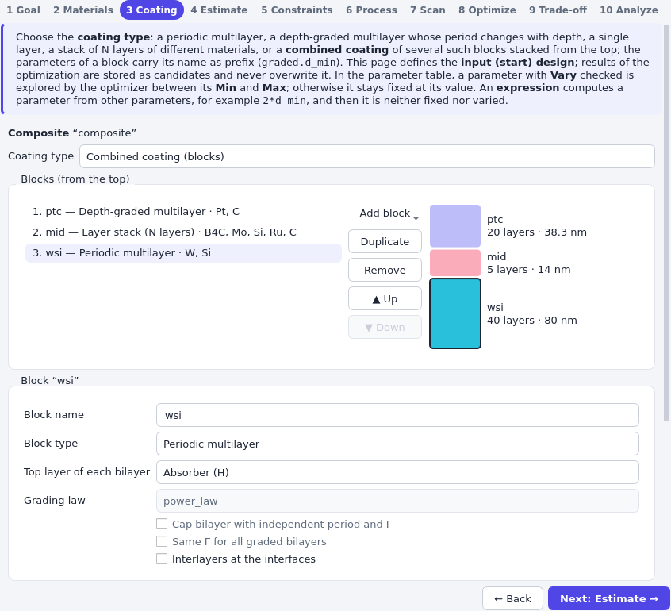
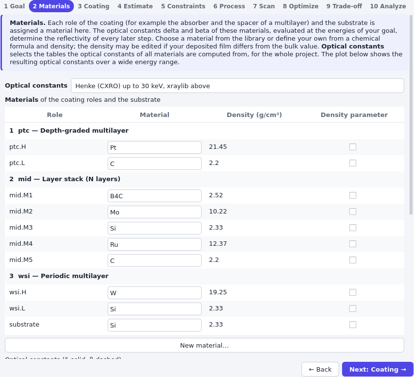

# Combined coatings

Some mirrors are not one regular multilayer: a depth-graded section may sit on a periodic one, a
few single layers may separate two multilayers, or a capping layer may protect the top. A
*combined coating* stacks several coatings, its *blocks*, from the top down. Each block is an
ordinary coating (periodic, depth-graded, single layer or layer stack) with its own parameters and
materials. The example on this page has three blocks:

1. `ptc`: 10 bilayers of a depth-graded Pt/C multilayer on top,
2. `mid`: five single layers B<sub>4</sub>C, Mo, Si, Ru and C,
3. `wsi`: 20 bilayers of a periodic W/Si multilayer above the substrate.

## In the library

{py:class}`~grazing.core.structure.coatings.composite.Composite` combines the blocks. Their names
must be unique identifiers, because they become the prefix of the block's parameters and material
roles:

```python
import numpy as np

from grazing.core.materials import get
from grazing.core.physics import reflectivity
from grazing.core.structure import Composite, Mirror, Periodic
from grazing.core.structure.coatings import DepthGraded, NLayer
from grazing.core.units import deg

coating = Composite.create(
    [
        DepthGraded.create(get("Pt"), get("C"), N=10, d_min=3.0, d_max=6.0, name="ptc"),
        NLayer.create(
            [get(m) for m in ("B4C", "Mo", "Si", "Ru", "C")], [2.0, 3.0, 4.0, 2.0, 3.0], name="mid"
        ),
        Periodic.create(get("W"), get("Si"), N=20, d=4.0, name="wsi"),
    ]
)
mirror = Mirror(coating, get("Si"), substrate_roughness=0.3)
print(list(coating.parameters)[:4])
print({role: m.name for role, m in coating.materials.items() if role.startswith("wsi")})
print({name: len(layers) for name, layers in coating.layers_by_block().items()})

stack = mirror.stack()
r = reflectivity(stack, 8048.0, np.linspace(deg(0.1), deg(3.0), 300))
print(f"{len(stack.layers)} layers, maximum reflectivity {r.max():.2f}")
```

The parameters are named `ptc.N`, `ptc.d_min`, …, `wsi.d`, and the material roles `ptc.H`,
`mid.M3`, `wsi.L`. Everything that works with a coating works with a combined one: parameters are
varied with `Mirror.with_parameter`, optimizers and fits see all parameters, density parameters
are named after the prefixed role (`wsi.rho_H`), and the deposition time and the layer
constraints act on the layers of all blocks.

An expression may refer to the parameters of another block. Here the largest period of the graded
section follows the period of the periodic section:

```python
mirror = mirror.with_parameter("wsi.d", vary=True, min=3.5, max=4.5)
mirror = mirror.with_parameter("ptc.d_max", expr="1.5 * wsi.d")
print(mirror.parameters.evaluate()["ptc.d_max"])
```

### Editing the blocks

The editing methods return a modified copy and keep the settings (value, vary, bounds, expression)
of all parameters of the other blocks:

| Method | Effect |
|---|---|
| `with_block(name, block)` | Replace a block, e.g. by a coating of another type. |
| `insert_block(index, block)` | Insert a block at a position from the top. |
| `remove_block(name)` | Remove a block; expressions that refer to it become fixed values. |
| `move_block(name, index)` | Move a block. |
| `rename_block(name, new_name)` | Rename a block, its parameters, and the references in expressions. |
| `with_material(role, material)` | Change the material of a prefixed role, e.g. `"wsi.H"`. |

`block(name)` returns a block with the current settings, so a block is modified like any coating
and put back with `with_block`:

```python
from grazing.core.structure import SingleLayer

coating = mirror.coating
wsi = coating.block("wsi").with_interlayers(True)
coating = coating.with_block("wsi", wsi).with_material("wsi.interlayer_H_on_L", get("WSi2"))
coating = coating.insert_block(0, SingleLayer.create(get("B4C"), t=2.0, name="cap"))
coating = coating.rename_block("mid", "glue")
print(coating.block_names())
print(coating.parameters["wsi.d"].vary, coating.parameters["ptc.d_max"].expr)
```

The Bragg estimate (`BraggOutline`) needs a single periodic or depth-graded coating; for a combined
coating it leaves the start values unchanged.

## In the applications

On the **Coating** step of grazing-design (and the **Structure** step of grazing-fit), choose the
coating type *Combined coating (blocks)*. The current coating becomes the first block.



- **Blocks (from the top)** lists the blocks. *Add block* inserts a block of the chosen type below
  the selected one, *Duplicate* copies the selected block, *Remove* deletes it, and *▲ Up* / *▼ Down*
  move it. The sketch next to the list shows the blocks with their number of layers and thickness;
  clicking a block selects it.
- Below, **Block name**, **Block type**, the options (top layer, grading law, cap, same Γ,
  interlayers) and the layer table belong to the selected block.
- The parameter table shows the parameters of all blocks; *Show: Selected block* limits it to the
  selected one.
- The **Materials** step lists the roles grouped by block, with material, density and density
  parameter per role.



Choosing a single coating type again converts the selected block and drops the others; *Undo*
restores them.
