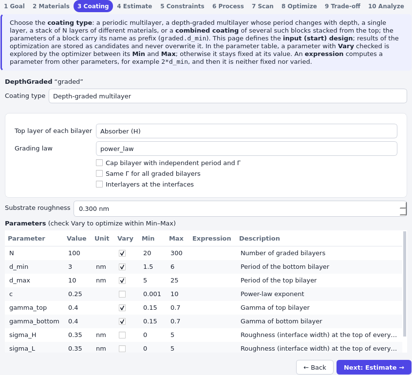
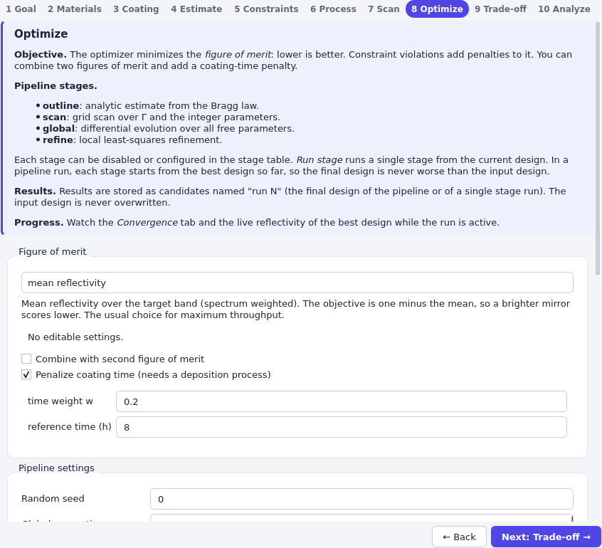
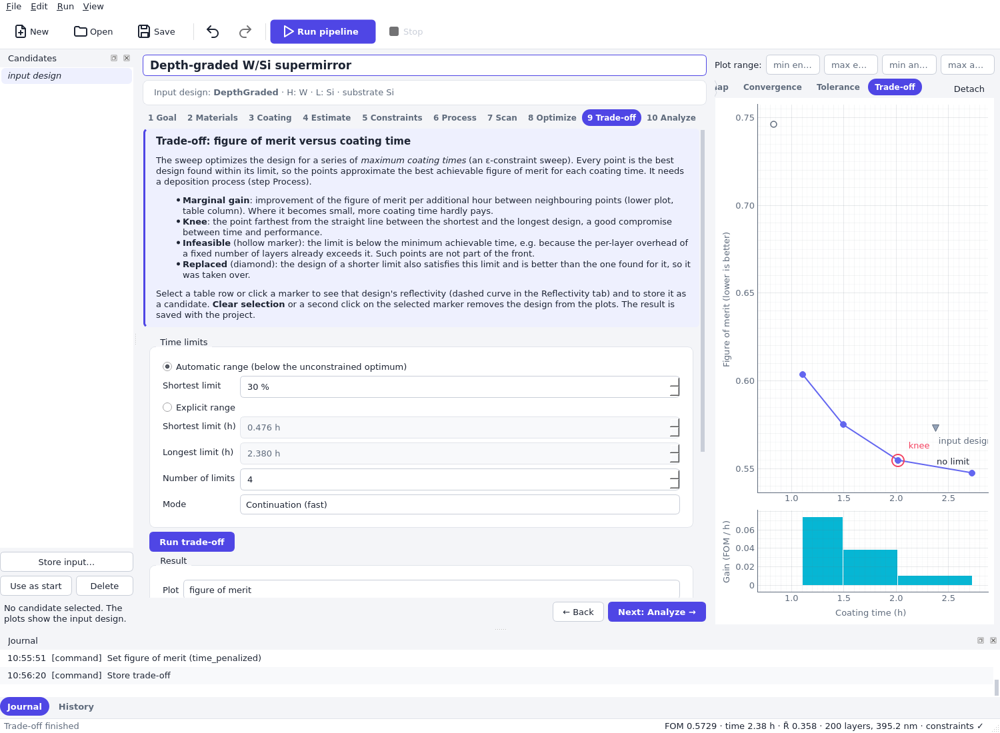

# Depth-graded supermirrors and the coating time

A periodic multilayer reflects a narrow band. To reflect a broad range of energies or angles, the
period must change with depth: thick bilayers near the surface reflect low energies (or the largest
angles), thinner bilayers deeper down reflect higher energies, which penetrate further. Such a
*depth-graded multilayer* or *supermirror* has many layers, so it takes long to deposit, and its
reflectivity is a compromise over the band. This page shows how to design one and how to decide how
much reflectivity is worth how much coating time.

The example is a broadband hard X-ray mirror, as used in focusing telescopes: a W/Si multilayer
that reflects 15 to 70 keV at a fixed grazing angle of 0.2°. It is also the script
`examples/graded_time_penalty.py`. The physics of graded multilayers is summarized in
[Depth-graded multilayers](../../physics_background.md).

## The graded coating

The coating {py:class}`~grazing.core.structure.coatings.graded.DepthGraded` has these parameters:

| Parameter | Meaning |
|---|---|
| `N` | Number of bilayers (integer). |
| `d_max`, `d_min` | Period of the top and of the bottom bilayer in nm. |
| `c` | Exponent of the power law (power law only). |
| `gamma_top`, `gamma_bottom` | Absorber fraction Γ of the top and bottom bilayer; Γ changes linearly in between. |
| `sigma_H`, `sigma_L` | Interface roughness in nm. |

The grading law decides how the period changes with the bilayer index. The default is the power law
d<sub>i</sub> = a / (b + i)<sup>c</sup>, used for NuSTAR-type mirrors with an exponent c around
0.2 to 0.25; the constants a and b follow from d<sub>max</sub> and d<sub>min</sub>. The alternative
is a linear change. Laws are registered by name in
{py:data}`~grazing.core.structure.coatings.graded.grading_laws`.

```python
import numpy as np

from grazing.core.structure.coatings.graded import grading_laws

values = {"d_min": 3.0, "d_max": 10.0, "c": 0.25}
for name in ("power_law", "linear"):
    periods = grading_laws.get(name).periods(100, values)
    print(f"{name:10s} periods of bilayers 1, 10, 50, 100: {np.round(periods[[0, 9, 49, 99]], 2)}")
```

The power law keeps the periods large near the top and lets them decrease quickly, so that more
bilayers serve the high end of the band, where the reflectivity per bilayer is lowest. Γ is usually
graded too: deep layers see only the high energies and are thus better with different Γ than the
top layers. Both are free parameters of the optimization here; fix `c` as a plain number (as below)
to keep one parameter less. The *Cap bilayer* option adds a top bilayer with its own period and Γ
that reflects the lowest energies and protects the stack.

## Why the coating time matters

The number of bilayers of a supermirror is large, and each layer costs a fixed overhead (shutter,
target switching, rotation) on top of the time for its thickness. Reflectivity grows with `N`
but saturates: the last bilayers add little. A figure of merit that only rates the reflectivity
therefore chooses a design with hundreds of layers for a marginal gain.
{py:class}`~grazing.design.merit.composite.TimePenalized` adds the coating time T to the figure of
merit F of the optics:

(1 − w)·F + w·T / T<sub>ref</sub>

with the weight w in [0, 1] and the reference time T<sub>ref</sub>. The time enters relative to T<sub>ref</sub>
so that both terms have a comparable size: choose T<sub>ref</sub> as the longest acceptable coating
time (or the time of a typical design). A weight of 0 optimizes the reflectivity only; larger weights
trade reflectivity for time. The weight has no physical unit, it expresses your preference. The
time requires a {py:class}`~grazing.design.manufacturing.process.DepositionProcess`.

Compare it with a **constraint**: `MaxCoatingTime` forbids designs above a limit, whatever their
reflectivity, and the optimizer gets no incentive to stay below it. The penalty ranks designs
by a smooth preference. The two combine well: a hard limit that you cannot exceed, a penalty
that avoids wasting time below it.

```python
from grazing.core.materials import get
from grazing.core.optim.optimizers import LmfitOptimizer
from grazing.core.parameters import free
from grazing.core.structure import DepthGraded, Mirror
from grazing.core.targets import EnergyScan, TargetSet
from grazing.core.units import deg, kev
from grazing.design.manufacturing import (
    DepositionProcess,
    MaxCoatingTime,
    MaxTotalThickness,
    MinLayerThickness,
)
from grazing.design.merit import MeanReflectivity, TimePenalized
from grazing.design.optim import DesignProblem, Pipeline
from grazing.design.optim.stages import Stage

HOUR = 3600.0
tungsten, silicon = get("W"), get("Si")


def build_problem(weight: float) -> DesignProblem:
    coating = DepthGraded.create(
        tungsten,
        silicon,
        N=free(100, 20, 300),
        d_min=free(3.0, 1.5, 6.0),
        d_max=free(10.0, 5.0, 25.0),
        c=0.25,
        gamma_top=free(0.4, 0.15, 0.7),
        gamma_bottom=free(0.4, 0.15, 0.7),
        sigma_H=0.35,
        sigma_L=0.35,
    )
    process = DepositionProcess(
        {"W": 0.1, "Si": 0.2}, overhead_per_layer=20.0, fixed_overhead=1800.0
    )
    targets = TargetSet(
        EnergyScan(angle=deg(0.2), energy_min=kev(15), energy_max=kev(70), points=150)
    )
    return DesignProblem(
        Mirror(coating, silicon, 0.3),
        targets,
        TimePenalized(MeanReflectivity(), weight=weight, reference_time=8 * HOUR),
        constraints=(MinLayerThickness(0.8), MaxTotalThickness(1500.0), MaxCoatingTime(24 * HOUR)),
        process=process,
    )


def small_pipeline(problem: DesignProblem) -> Pipeline:
    """Default pipeline with small budgets, to keep this page fast."""
    default = Pipeline.default(
        problem, seed=1, global_iterations=4, scan_points=4, coarse_points=40
    )
    return Pipeline(
        tuple(
            Stage("refine", LmfitOptimizer("least_squares", 150)) if s.name == "refine" else s
            for s in default.stages
        )
    )
```

The coating has the constraints of a real process: layers of at least 0.8 nm, a total thickness of at
most 1.5 µm (stress, adhesion) and a coating time of at most 24 h. The deposition process is
magnetron sputtering at 0.1 nm/s for W and 0.2 nm/s for Si, 20 s of overhead per layer and
30 min of set-up.

Now optimize for the reflectivity only (w = 0) and for an equal weight of reflectivity and time
(w = 0.5):

```python
designs = {}
for weight in (0.0, 0.5):
    problem = build_problem(weight)
    result = small_pipeline(problem).run(problem)
    designs[weight] = result
    final = result.final
    assert final.stack is not None and final.coating_time is not None
    print(
        f"w = {weight}: mean R = {float(final.results[0].reflectivity.mean()):.3f}, "
        f"coating time = {final.coating_time / HOUR:.1f} h, "
        f"{final.stack.num_layers} layers, {final.stack.total_thickness:.0f} nm, "
        f"feasible = {final.feasible}"
    )
```

In this run, the reflectivity-only design has about 450 layers and a coating time of about 4.6 h. The
balanced design has about 40 layers and 1 h, a tenth of the layers and a fifth of the time, for a mean
reflectivity of 0.28 instead of 0.42. The numbers
depend on the budget of the pipeline (small here); with the default budget the optimum is smoother, but
the message is the same: the weight is a lever, and the correct setting depends on what an hour of
coating costs for you. Comparing the designs at one weight gives no answer to that question; the
trade-off sweep below does.

## The trade-off between reflectivity and time

{py:func}`~grazing.design.optim.tradeoff.time_tradeoff` optimizes the problem for a series of maximum
coating times (a so-called ε-constraint sweep). Each point is the best design that was found within
its time limit, so the points trace the best achievable reflectivity as a function of the time you
are willing to spend. With a weight of 0 the sweep isolates the reflectivity (with a nonzero weight
the figure of merit already contains a time term).

```python
from grazing.design.optim.tradeoff import time_tradeoff

problem = build_problem(0.0)
tradeoff = time_tradeoff(problem, points=4, lowest=0.3, pipeline=small_pipeline(problem))

print("limit (h)  time (h)  mean R  feasible")
for point in tradeoff.points:
    limit = "none" if point.limit == float("inf") else f"{point.limit / HOUR:.2f}"
    mean_r = dict(point.quantities)["mean reflectivity"]
    print(f"{limit:>9s}  {point.coating_time / HOUR:8.2f}  {mean_r:6.3f}  {point.feasible}")

knee = tradeoff.knee()
if knee is not None:
    print(f"knee at {knee.coating_time / HOUR:.2f} h")
```

How the sweep works:

- Without explicit `limits`, the problem is first optimized without a time limit (the row `none`).
  The `points` limits are then spaced on a log scale from `lowest` times that design's coating time up to
  just below it. Pass `limits=[…]` in seconds to choose them yourself; then the unconstrained design
  is not computed.
- In the default mode `"continuation"`, the longest limit is optimized with the full pipeline, and each
  shorter limit starts from the previous design, scans `N` and refines locally. This is much faster
  than `mode="thorough"`, which runs the full pipeline for every limit.
- A design found for a shorter limit also satisfies every longer limit. If it is better than the
  design found for a longer limit, it replaces it (`TradeoffPoint.replaced`), so the front never
  gets worse with more time.
- `feasible` is false when the limit cannot be met at all, for example because the overhead of
  the minimum number of layers already exceeds it.

In this run, the front rises from a mean reflectivity of about 0.32 at 1.4 h to 0.395 at 2.5 h (the
knee) and only 0.418 at 4.6 h, so the last two hours buy 0.02.

Reading the result:

- **Marginal gain**: {py:meth}`~grazing.design.optim.tradeoff.TradeoffResult.marginal_gains`
  gives the improvement of the figure of merit per additional hour between neighbouring points.
  The front is steep at the left (a little time gives much reflectivity) and flat at the right.
  Where the gain falls below the value of an hour to you, the extra time is not worth it.
- **Knee**: {py:meth}`~grazing.design.optim.tradeoff.TradeoffResult.knee` is the point farthest from
  the straight line between the shortest and the longest design (with both axes scaled to [0, 1]): the
  best compromise if you have no other criterion. It returns `None` for fewer than three feasible points
  or an almost straight front.

Choose the design on the front, and use it as the start of a final, large-budget run: set its coating
time as the `MaxCoatingTime` constraint, or set `weight` and `reference_time` such that the
penalty has the slope of the front at that point.

## In the application

Create the project with **File > New…**, *Depth-graded multilayer, power law*, W/Si. Set the target
in the Goal step (*Fixed angle*, 0.2°, 15 to 70 keV).



The Coating step offers the *Grading law* (`power_law` or `linear`), *Cap bilayer with independent period and Γ*, and *Same Γ for all
graded bilayers*, which ties `gamma_bottom` to `gamma_top`. Unchecked, Γ changes linearly with depth,
as in the library example. Leave *Interlayers at the interfaces* off. In the parameter table, free `N`, `d_min`, `d_max`, `gamma_top` and
`gamma_bottom` fix `c` and the roughness `sigma_H` and `sigma_L` at 0.35 nm, and set the *Substrate roughness* to 0.3 nm as in the library example.

Enable the deposition process (Process step) with the same rates and overheads, and add the three
constraints in the Constraints step. In the Optimize step, tick **Penalize coating time (needs a
deposition process)** and set the time weight w and the reference time:



The *Layer profile* tab shows the result: the thickness of each layer, the period d on the
way from the top to the bottom, and Γ from `gamma_top` to `gamma_bottom`.

The **Trade-off** step needs a deposition process; without one, *Run trade-off* is disabled. It
uses the pipeline of the Optimize step.



- *Automatic range* optimizes without a limit first and uses *Number of limits* limits from
  *Shortest limit* (percent of that design's coating time) up to just below it. *Explicit
  range* takes a shortest and a longest limit in hours.
- *Mode*: *Continuation (fast)* or *Thorough*, as in the library.
- *Plot* selects the plotted quantity: the figure of merit or a quantity it rates, such as the mean
  reflectivity.
- The upper plot shows the best figure of merit against the coating time; infeasible
  points are hollow grey markers, points taken over from a shorter limit are diamonds, the
  knee has a ring. The input design and the stored candidates appear as triangles for comparison,
  so you can see how far they are from the front. The lower plot shows the marginal gain between
  neighbouring points.
- Click a row of the table or a marker to draw that design's reflectivity (dashed) in the Reflectivity
  tab, and **Store as candidate** to keep it (named “trade-off <limit> h”) for the further analysis
  and the recipe export. **Clear selection**, or a second click on the selected marker, removes the
  design from the plots again.

The result is saved with the project. The figure above used the weight of 0.2, so the figure of merit
of the plot includes the time term; set the weight to zero for a pure reflectivity front.

## Related

- [Tolerances, process and recipe](design_tolerances.md): a many-layer design is the most
  sensitive to errors; check it before you commit.
- [Optimize for several targets](design_multiple_targets.md): a supermirror used at several angles.
- [Design a mirror with Python](../quickstart_design_library.md): the basic workflow.
