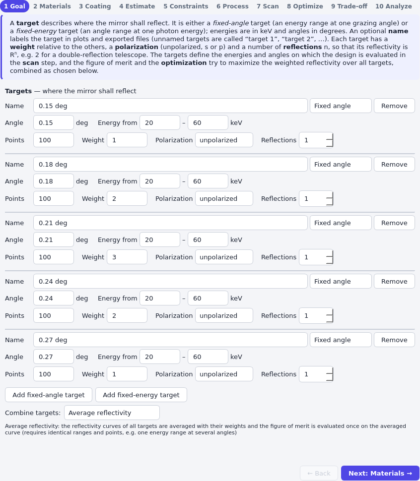
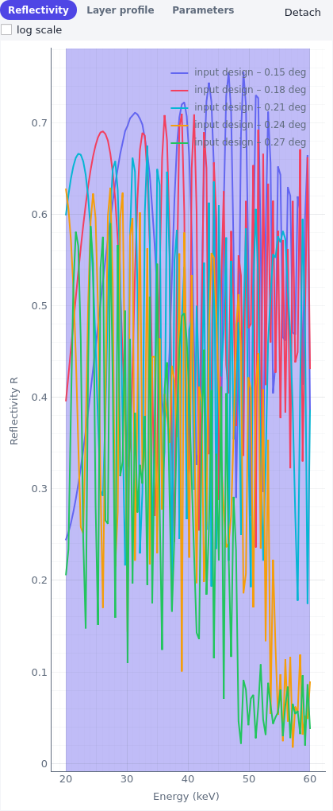

# Optimize for several targets

A single coating is often used under more than one condition: a focusing optic reflects at an
incidence angle that varies along its length, a beamline mirror serves two energy bands, a telescope
mirror reflects twice. The design problem holds a list of *targets*, each with a weight, and a
rule that combines them into one figure of merit. This page shows the three decisions involved: how
the targets are combined, how they are weighted, and how several reflections are described.

The running example is the script `examples/coupled_angles.py`: one depth-graded W/Si coating
for five grazing angles (0.15°, 0.18°, 0.21°, 0.24° and 0.27°) over the energy band of 20 to 60 keV,
for example on an optic whose angle changes along its length.

## Several targets in a design problem

A {py:class}`~grazing.core.targets.TargetSet` holds the targets and the `combine` mode. Every
{py:class}`~grazing.core.targets.EnergyScan` (an energy range at a fixed angle) or
{py:class}`~grazing.core.targets.AngleScan` (an angle range at a fixed energy) has a `weight`, a
`polarization`, the number of `points` and a number of `reflections`. Optional names label the targets
in plots and in exported files.

```python
from dataclasses import replace

from grazing.core.materials import get
from grazing.core.optim.optimizers import LmfitOptimizer
from grazing.core.parameters import free
from grazing.core.structure import DepthGraded, Mirror
from grazing.core.targets import EnergyScan, Target, TargetSet
from grazing.core.units import deg, kev
from grazing.design.manufacturing import MinLayerThickness
from grazing.design.merit import MeanReflectivity, SoftMinReflectivity
from grazing.design.optim import DesignProblem, Pipeline
from grazing.design.optim.stages import Stage

tungsten, silicon = get("W"), get("Si")
coating = DepthGraded.create(
    tungsten,
    silicon,
    N=free(80, 20, 250),
    d_min=free(3.0, 1.5, 6.0),
    d_max=free(10.0, 4.0, 25.0),
    c=0.25,
    gamma_top=free(0.4, 0.15, 0.7),
    gamma_bottom=free(0.4, 0.15, 0.7),
    sigma_H=0.35,
    sigma_L=0.35,
)
mirror = Mirror(coating, silicon, 0.3)

angles = (0.15, 0.18, 0.21, 0.24, 0.27)  # grazing angles in degrees
weights = (1.0, 2.0, 3.0, 2.0, 1.0)
scans: list[Target] = [
    EnergyScan(
        angle=deg(angle),
        energy_min=kev(20),
        energy_max=kev(60),
        points=60,
        weight=weight,
        name=f"{angle} deg",
    )
    for angle, weight in zip(angles, weights, strict=True)
]
problem = DesignProblem(
    mirror,
    TargetSet(scans, combine="average_reflectivity"),
    MeanReflectivity(),
    constraints=(MinLayerThickness(0.8),),
)
```

## Weights

The weights are relative: they are normalized to a sum of one
({py:meth}`~grazing.core.targets.TargetSet.normalized_weights`). Here the central angle counts three times
as much as the outermost ones, because the optic spends more of its length there. Weights express
*importance*, so choose them from the application: the fraction of the aperture, of the photon flux,
or of the user time that is spent in each condition. The optimizer improves the heavily weighted
target first when it has to choose. Giving one target a weight of zero is not possible (weights must be
positive); remove the target instead.

## How the targets are combined

The two `combine` modes differ in *where* the targets are averaged.

**`"average_reflectivity"`** averages the weighted reflectivity curves of all targets and evaluates the
figure of merit *once*, on the averaged curve. It treats the targets as one combined condition: the
mirror is rated by the reflectivity that results from the mix, as for a beam that contains all the
angles at the same time. It requires that all targets have the same scan axis, range and number
of points, so that the curves can be added point by point.

**`"average_merit"`** evaluates the figure of merit separately for each target and averages the
*results* with the weights. The targets may differ in axis, range, points and even
polarization. Use it when the targets describe separate operating conditions, so that each must be
good in its own right.

For the mean reflectivity the two modes give the same number when the grids are identical, because
averaging is linear. They differ for figures of merit that are not linear in the curve. Compare
them for a figure of merit that rates the weakest part of the band, here for the design of the next
section:

```python
default = Pipeline.default(problem, seed=1, global_iterations=4, scan_points=4, coarse_points=30)
pipeline = Pipeline(
    tuple(
        Stage("refine", LmfitOptimizer("least_squares", 150)) if s.name == "refine" else s
        for s in default.stages
    )
)
result = pipeline.run(problem)
optimized = problem.with_parameters(result.parameters)

print("Mean reflectivity per angle (20 to 60 keV)")
for target, curve in zip(problem.targets.targets, result.final.results, strict=True):
    print(f"  {target.name:9s} weight {target.weight:g}: {float(curve.reflectivity.mean()):.3f}")
print(f"figure of merit (1 - weighted mean R): {result.final.merit:.3f}")

soft = optimized.evolve(merit=SoftMinReflectivity())
by_merit = soft.evolve(targets=TargetSet(scans, combine="average_merit"))
print(f"soft-min merit, average_reflectivity: {soft.evaluate().merit:.3f}")
print(f"soft-min merit, average_merit:        {by_merit.evaluate().merit:.3f}")
```

The first lines show the central result: **one coating cannot be best everywhere**. The reflectivity
decreases towards the larger angles, because the highest energy that a given range of periods reflects
scales inversely with the angle. The figure of merit is the weighted mean of the per-angle values.
With `average_reflectivity` the soft minimum is taken of the averaged curve, in which the weak parts
of one angle are compensated by the others. With `average_merit` it is taken per angle and then
averaged, so the merit is higher (worse): every angle has to be good on its own. Choose by what you need: a beam that contains all angles at once (average the curves),
or a mirror that must work at each angle separately (average the merit).

Targets with *different* ranges can only be combined with `average_merit`:

```python
low = EnergyScan(angle=deg(0.25), energy_min=kev(20), energy_max=kev(30), points=40, name="low")
high = EnergyScan(angle=deg(0.15), energy_min=kev(40), energy_max=kev(60), points=40, name="high")
try:
    TargetSet([low, high])
except ValueError as error:
    print(f"average_reflectivity: {error}")

bands = TargetSet([replace(low, weight=3.0), high], combine="average_merit")
two_bands = problem.evolve(targets=bands)
result_bands = pipeline.run(two_bands)
for target, curve in zip(bands.targets, result_bands.final.results, strict=True):
    print(
        f"{target.name:5s} weight {target.weight:g}: mean R = {float(curve.reflectivity.mean()):.3f}"
    )
```

The default `combine` is `"average_reflectivity"`, which rejects targets with different ranges when the
`TargetSet` is created, as the first message shows. Averaging the merit works, and the weights 3 : 1 give the low band
three times the influence of the high band on the compromise; repeat the run with equal weights to see
how the two mean reflectivities move.

## Several reflections

A telescope mirror shell reflects the photon twice, a monochromator with two crystals (or two
multilayers) reflects twice. The reflectivity of the system is Rⁿ for n reflections from identical
coatings. Set `reflections=n` on the target: the evaluated reflectivity, the plots and the
figure of merit then use Rⁿ.

```python
two_reflections = TargetSet(
    [replace(t, reflections=2) for t in scans], combine="average_reflectivity"
)
double = optimized.evolve(targets=two_reflections)
print(f"1 - mean R after one reflection:  {optimized.evaluate().merit:.3f}")
print(f"1 - mean R after two reflections: {double.evaluate().merit:.3f}")
```

Rⁿ punishes weak parts of the band disproportionately: a reflectivity of 0.5 gives 0.25 after two
reflections. Because the figure of merit is evaluated on Rⁿ, the optimizer weighs the weak regions
accordingly. Set `reflections` for the real system, instead of optimizing the single reflectivity and
squaring the result afterwards.

## In the application

The Goal step lists the targets, one block each, with *Name*, the scan type (*Fixed angle* or
*Fixed energy*), the fixed value, the range, *Points*, *Weight*, *Polarization* and *Reflections*.
Use **Add fixed-angle target** or **Add fixed-energy target** for another one and **Remove** to delete
a target. The weights are relative.



**Combine targets** selects *Average reflectivity* or *Average figure of merit*; the text below it
describes the selected mode. With the first, the page requires identical scan ranges and points, and
shows an error otherwise. In the Estimate step, a *Target* selector appears with more than one target:
*All targets* pools the ends and centres of all of them, which is meaningful if they have similar
energies and angles; choose a single target if they do not. The `outline` stage of the pipeline has the
same selector in the *Stages* table of the Optimize step.



The Reflectivity tab draws one curve per target, with the target name in the legend. The figure shows
the five angles of the design after a minimal pipeline run; the budget is small, so the curves are not
converged. For a real design, use the default pipeline settings. Plot the individual targets to see
which condition limits the design, and change the weights if the compromise is not what you want.
The curve of a target with `reflections` greater than one is Rⁿ, and the axis label says so. Candidate
export (*Export reflectivity…* in the context menu of the candidate list) writes one block of rows
per target, with the columns `target`, `axis`, `reflections`, the single-reflection `reflectivity` and
`reflectivity^N`.

## Related

- [Depth-graded supermirrors and the coating time](design_depth_graded.md)
- [Design a mirror in grazing-design](../quickstart_design_gui.md)
- {py:class}`grazing.core.targets.TargetSet` and the figures of merit in the
  [physics background](../../physics_background.md).
