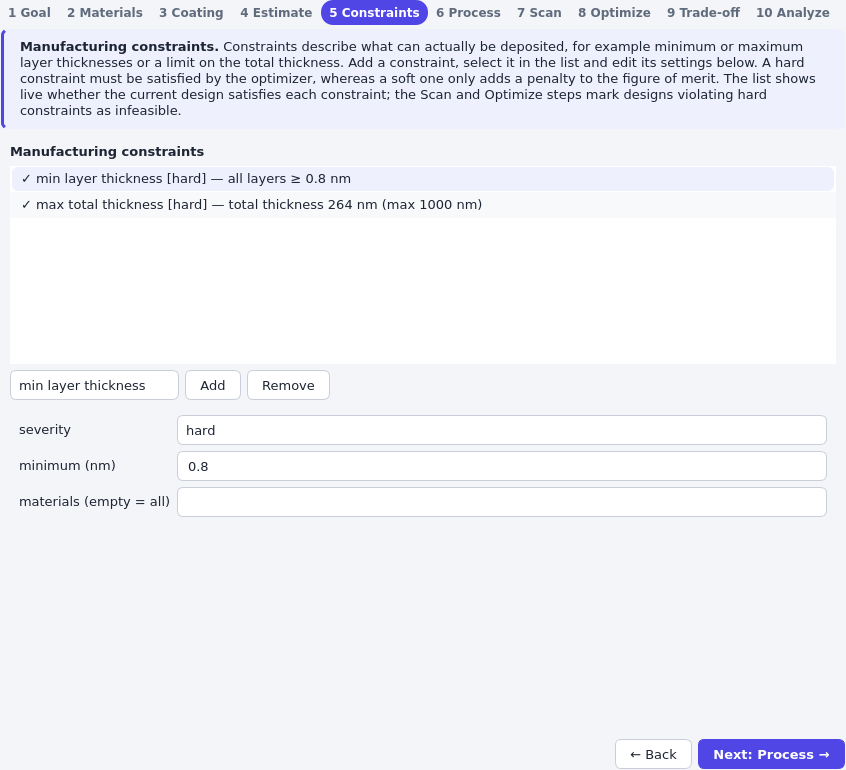
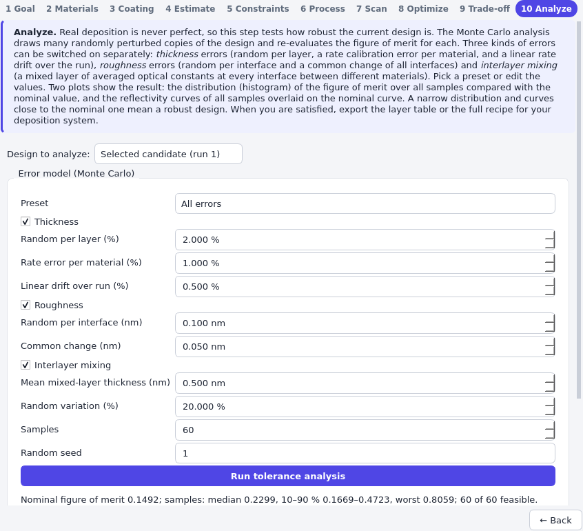
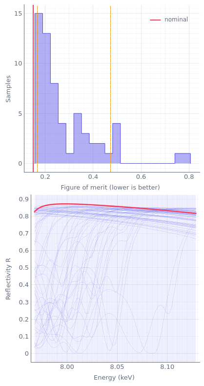

# Tolerances, process and recipe

A design is only as good as the coating that comes out of the machine. This page covers the three
parts of xstack that connect a design to manufacturing: the *constraints* that keep a design within what
can be deposited, the *process model* that gives the coating time, and the *tolerance analysis* that
shows how the design reacts to errors, followed by the export of the *recipe*. The examples use the
periodic W/B4C monochromator of the quick starts ([GUI](../quickstart_design_gui.md),
[library](../quickstart_design_library.md)).

```python
from xstack.core.materials import get
from xstack.core.parameters import free
from xstack.core.structure import Mirror, Periodic
from xstack.core.targets import EnergyScan, TargetSet
from xstack.core.units import deg
from xstack.design.manufacturing import (
    DepositionProcess,
    MaxCoatingTime,
    MaxLayers,
    MaxTotalThickness,
    MinLayerThickness,
)
from xstack.design.merit import MeanReflectivity
from xstack.design.optim import DesignProblem
from xstack.design.optim.stages import BraggOutline

ENERGY = 8048.0
tungsten, carbide, silicon = get("W"), get("B4C"), get("Si")
coating = Periodic.create(
    tungsten,
    carbide,
    N=free(60, 20, 150),
    d=free(4.4, 2.0, 8.0),
    gamma=free(0.4, 0.1, 0.8),
    sigma_H=0.3,
    sigma_L=0.3,
)
targets = TargetSet(
    EnergyScan(
        angle=deg(1.0),
        energy_min=0.99 * ENERGY,
        energy_max=1.01 * ENERGY,
        points=61,
        polarization="s",
    )
)
process = DepositionProcess(
    {"W": 0.1, "B4C": 0.05},
    overhead_per_layer=15.0,
    overhead_per_material={"B4C": 5.0},
    fixed_overhead=1800.0,
)
problem = DesignProblem(
    Mirror(coating, silicon, 0.3),
    targets,
    MeanReflectivity(),
    constraints=(
        MinLayerThickness(0.8),
        MaxTotalThickness(1000.0),
        MaxLayers(200),
        MaxCoatingTime(4 * 3600.0),
    ),
    process=process,
)
# A good design from the analytic estimate; it is enough to illustrate the analysis.
design = problem.with_parameters(BraggOutline(refraction=True).run(problem).parameters)
```

## The process model: coating time

{py:class}`~xstack.design.manufacturing.process.DepositionProcess` computes the coating time of a stack
as

T = t<sub>fixed</sub> + Σ<sub>layers</sub> ( t / rate + t<sub>layer</sub> + t<sub>material</sub> )

with the thickness t of each layer of non-zero thickness, the deposition rate of its material in
nm/s, an overhead per layer (shutter, target switching, substrate rotation), an extra overhead per layer
of a given material (for example for pre-sputtering) and a fixed overhead per run (pump-down,
warm-up), all in seconds. Typical numbers are in the
[manufacturing aspects](../../physics_background.md) of the physics background.

The model is deliberately simple: it assumes sequential deposition at constant rates and covers
the cost that matters for the design, which is the number and thickness of the layers. A design with
many thin layers is dominated by the per-layer overhead, which is why a graded mirror's time
cannot be guessed from its thickness alone
([Depth-graded supermirrors](design_depth_graded.md)).

```python
evaluation = design.evaluate()
stack = evaluation.stack
assert stack is not None and evaluation.coating_time is not None
print(
    f"{stack.num_layers} layers, {stack.total_thickness:.0f} nm, {evaluation.coating_time / 3600:.2f} h"
)
first, second = process.schedule(stack)[:2]
print(
    f"step 1: {first.material} {first.thickness:.2f} nm, {first.duration:.0f} s from t = {first.start_time:.0f} s"
)
print(f"step 2: {second.material} {second.thickness:.2f} nm, {second.duration:.0f} s")
```

`process.schedule(stack)` lists the layers in deposition order (step 1 is on the substrate) with the
duration and the start time of each. The recipe export below uses the same schedule. In the
application, the *Process* step has the same inputs: the table of rates and per-material overheads, the
overhead per layer in s, the fixed overhead per run in h, and the resulting coating time.

## Constraints

A {py:class}`~xstack.design.manufacturing.constraints.Constraint` rates a design for what can be
manufactured. The built-in ones are `MinLayerThickness(minimum, materials)` (an empty
`materials` means all), `MaxTotalThickness`, `MaxLayers` and `MaxCoatingTime` (which needs the
process). Each has a `severity`:

- **hard** (the default): the optimizer must satisfy it. A violation adds a large penalty, so
  that every feasible design beats every infeasible one, while infeasible designs are still
  ranked by how much they violate. `Evaluation.feasible` is false.
- **soft**: a violation adds a penalty proportional to the square of the normalized violation to
  the figure of merit, which can be traded against reflectivity. The design remains *feasible*.

```python
bad = design.with_parameters(design.parameters.with_values({"gamma": 0.1}))
result = bad.evaluate()
print(f"merit {result.merit:.3f}, objective {result.objective:.3f}, feasible = {result.feasible}")
for constraint, outcome in result.constraints:
    if not outcome.satisfied:
        print(f"{constraint.type_name} ({constraint.severity}): {outcome.message}")

soft = bad.evolve(constraints=(MinLayerThickness(0.8, severity="soft"),))
relaxed = soft.evaluate()
print(f"soft: objective {relaxed.objective:.3f}, feasible = {relaxed.feasible}")
```

The *objective* is the figure of merit plus the penalties; the optimizer minimizes it. A feasible
design has an objective equal to its figure of merit. Which severity to choose:

- **Minimum layer thickness** is *hard*: below roughly 1 nm, a layer is a set of islands, and the
  calculated reflectivity does not apply. The optimum of a W/B4C mirror is a very thin W
  layer, so this constraint is active and shapes the result. Constrain single materials with
  `materials=("W",)` if only one of them is critical.
- A **total thickness** or **number of layers** limit protects against film stress and
  delamination; it can be soft if the limit is a preference.
- A **coating time** limit is a hard budget, such as an overnight run. If you only prefer a shorter
  time, use the time penalty instead.

The optimizers also use the constraints to narrow the bounds of the parameters (for
`Periodic` the minimum thickness limits Γ to the range from t<sub>min</sub>/d to 1 − t<sub>min</sub>/d). In the
application, add and edit constraints in the *Constraints* step: choose the kind in the selector,
press **Add**, select it in the list and edit its settings below. The list shows a check mark or a cross
for each constraint as soon as you change the design.



## Tolerance analysis

The deposited coating differs from the design. The Monte Carlo
{py:func}`~xstack.design.manufacturing.tolerance.tolerance_analysis` draws random errors from an
{py:class}`~xstack.design.manufacturing.tolerance.ErrorModel`, builds the perturbed stack, and evaluates
the figure of merit of every sample. The figure of merit is evaluated on the *physical* stack,
including any mixed layers; the coating time and the constraints are evaluated on the stack *as
deposited*, so a sample is feasible if the real layers satisfy the constraints.

### The error model

| Error | `ErrorModel` field | GUI field | Meaning |
|---|---|---|---|
| Random thickness | `thickness_random` | Random per layer (%) | Independent relative error of each layer (1σ). Averages out over many layers. |
| Rate error | `thickness_systematic` | Rate error per material (%) | One relative error per material and run (a miscalibrated deposition rate). Scales all layers of the material together. |
| Rate drift | `thickness_drift` | Linear drift over run (%) | Linear change of the rate during the run; the last layer changes by this fraction, the first is unchanged. |
| Random roughness | `roughness_random` | Random per interface (nm) | Independent change of the roughness σ of each interface (1σ). |
| Common roughness | `roughness_systematic` | Common change (nm) | One change of the roughness of all interfaces of the run (1σ). |
| Interlayer mixing | `interlayer_thickness`, `interlayer_random` | Mean mixed-layer thickness (nm), Random variation (%) | A mixed layer at every interface between different materials, taking half of its thickness from each neighbour, with the volume-averaged optical constants. |

The application offers the presets *Thickness errors only* (2 % random), *Roughness only*,
*Interlayer mixing only*, *All errors* and *Custom* (editing a value switches to it). The
*Thickness*, *Roughness* and *Interlayer mixing* sections have a checkbox each. Choose the values from
your deposition system: the reproducibility of a layer thickness is usually a few percent for a
single layer; rate calibration and drift depend on the monitoring of the process.

```python
from xstack.design.manufacturing import ErrorModel, tolerance_analysis

models = {
    "random thickness 2 %": ErrorModel(thickness_random=0.02),
    "rate error 0.5 %": ErrorModel(thickness_systematic=0.005),
    "rate drift 1 %": ErrorModel(thickness_drift=0.01),
    "roughness 0.1 nm": ErrorModel(roughness_random=0.1, roughness_systematic=0.05),
    "mixing 0.5 nm": ErrorModel(interlayer_thickness=0.5, interlayer_random=0.2),
}
nominal = design.evaluate()
print(f"nominal mean R = {1 - nominal.merit:.3f}")
for label, errors in models.items():
    tol = tolerance_analysis(design, errors=errors, samples=40, seed=1)
    print(
        f"{label:22s} mean R: median {1 - tol.percentile(50):.3f}, "
        f"worst decile {1 - tol.percentile(90):.3f}"
    )
```

Use at least 100 samples and a fixed `seed` (to compare designs on the same random numbers) for
real work. The call also takes `values` (design parameters other than the current ones) and `cancel`
and `events` for background use.

### Interpreting the result

The result holds the `nominal` evaluation, the figure of merit `merits` of the samples, `feasible`, and
the evaluated `samples` including their reflectivity curves. In the application, the *Tolerance* tab
displays them:





- The **histogram** shows the figure of merit of all samples (lower is better) with the nominal value
  (a solid vertical line) and the 10 % and 90 % percentiles (dashed lines). Errors almost always make a
  tuned design worse, so the histogram is skewed to the right of the nominal value; a narrow histogram
  close to the nominal value means a robust design.
- The **10–90 % range** contains 80 % of the samples. The **90th percentile of the figure of
  merit is the pessimistic end**: nine of ten coatings are at least that good. Specify the design
  with the percentile that matches your yield requirement, not with the nominal value.
- The **sample curves** (at most 200 semi-transparent lines) with the nominal curve and a 10–90 % band
  show *how* the design fails: a shift of the peak (period errors), a lowered peak (roughness,
  mixing) or a changed bandwidth.
- The **summary** lists the nominal value, the median, the 10–90 % range, the worst sample and the number of
  feasible samples.

Two things to look for. First, *which error matters*: compare the models above. For this narrow-band
monochromator the rate drift is by far the most damaging error (a 1 % drift moves the Bragg peak of the
last layers by a large part of the ±1 % band), a rate error of 0.5 % or 2 % random thickness errors
already lower the worst decile noticeably, and roughness and mixing lower the whole peak without
spreading much. The remedy for a systematic error (rate error, drift) is a better calibration, such as
a witness sample or rate monitoring, rather than a different design. Second, *the feasible count*: it
checks the design against the real layers.

```python
errors = ErrorModel(thickness_random=0.02)
at_limit = tolerance_analysis(design, errors=errors, samples=40, seed=1)
print(f"design at the limit: {int(at_limit.feasible.sum())} of 40 samples feasible")

margin = problem.evolve(constraints=(MinLayerThickness(1.0), MaxTotalThickness(1000.0)))
safer = problem.with_parameters(BraggOutline(refraction=True).run(margin).parameters)
with_margin = tolerance_analysis(safer, errors=errors, samples=40, seed=1)
print(f"design with margin:  {int(with_margin.feasible.sum())} of 40 samples feasible")
```

The estimate puts the W layers *exactly* at the 0.8 nm limit, so that about half of the layers of each
sample are thinner than the limit and (almost) every sample is infeasible. A design that sits on a
constraint cannot tolerate any error in the direction of the violation. The remedy is to optimize
against a stricter limit than the process requires (1.0 nm here, a margin of 25 %) and to
check the design against the real limit; the cost is a small loss of nominal reflectivity.

## Export the recipe

{py:func}`~xstack.design.recipe.layer_table` returns one row per layer of non-zero thickness. The
columns are `step` (deposition order, 1 is on the substrate), `layer_index` (0 is the top layer),
`tag`, `material`, `formula`, `thickness_nm` and `roughness_nm` and, with a process, `duration_s` and
`start_s`. The rows are in deposition order or, with `order="top_down"`, from the surface down.

```python
import json

from xstack.design.recipe import layer_table, write_recipe_csv, write_recipe_json

stack = nominal.stack
assert stack is not None
rows = layer_table(stack, process, order="top_down")
print(f"{len(rows)} layers; surface layer: {rows[0]['material']} {rows[0]['thickness_nm']:.2f} nm")
write_recipe_csv("recipe.csv", stack, process)
write_recipe_json("recipe.json", stack, process)
recipe = json.load(open("recipe.json"))
print(list(recipe))
print(f"total {recipe['total_thickness_nm']:.0f} nm in {recipe['total_time_s'] / 3600:.2f} h")
```

The JSON file also holds the substrate, the ambient medium, the order and the total thickness and time. In
the application, the *Deposition recipe* box on the *Analyze* page writes both files for the analyzed
design (*Design to analyze*: the input design or the selected candidate): **Export layer table
(CSV)…** and **Export recipe (JSON)…**.

The recipe contains the *nominal* thicknesses of the optimized design with the rates of your
process definition. Before you use it on a real machine, calibrate the rates with a witness sample, and
verify the design against your constraints with margin, as shown above. The recipe does not contain the
mixed layers or other errors of the tolerance analysis; they are not part of the design.

## Related

- [Design a mirror in xstack-design](../quickstart_design_gui.md): the tolerance analysis and the recipe in the
  workflow.
- [Depth-graded supermirrors and the coating time](design_depth_graded.md): the coating time as a design
  goal.
