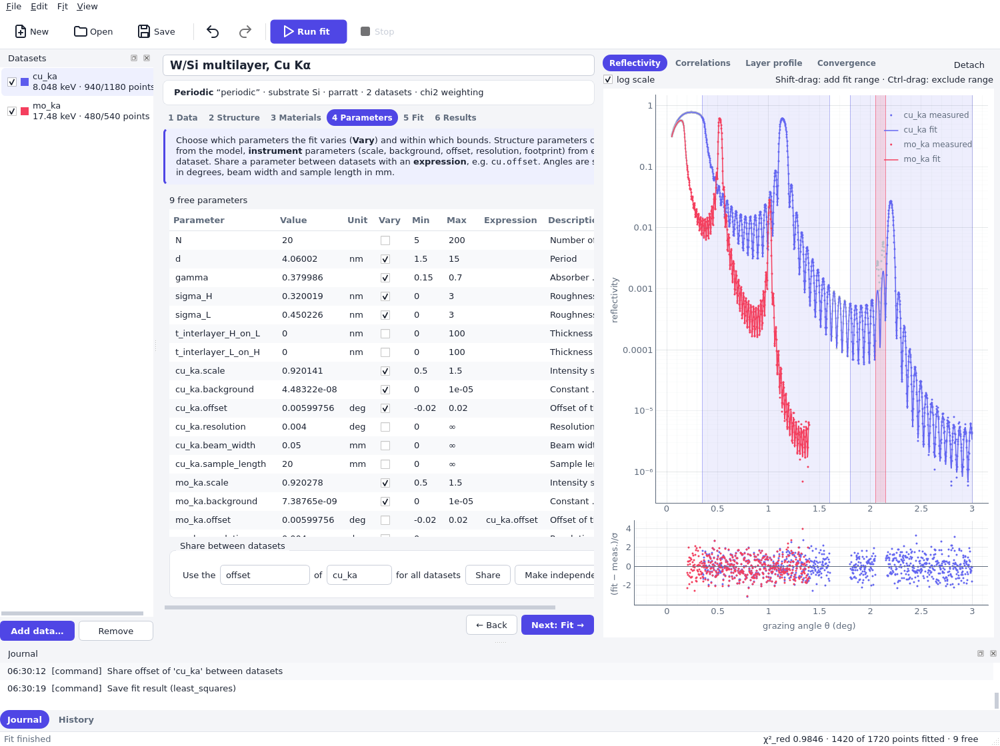

# Fitting several datasets together

One structure can be fitted to several measurements at once: reflectivity curves at different
photon energies, with different angular ranges, or from different instruments. This page fits the
W/Si multilayer of the quick starts with its Cu Kα curve (8048 eV,
`examples/data/WSi_multilayer_cu_ka.csv`) and a second curve measured with Mo Kα radiation
(17 479 eV, `examples/data/WSi_multilayer_mo_ka.csv`). Both files come from the same sample.

## Why fit simultaneously

The structure parameters (period, Γ, roughnesses) describe the sample, so they are the same for all
curves. The optical constants of the materials depend on the photon energy, and so does the
way in which the structure appears in the curve: roughness weakens the reflectivity much more at
the shorter wavelength, and the contrast between the layers differs. Parameters that compensate
each other in one curve are therefore often separated by a second one. A simultaneous fit uses all
this information, and it gives uncertainties that include it.

What is shared and what is not depends on the experiment:

- The **structure** is shared by construction: there is one structure in the project.
- The **instrument parameters** belong to each dataset: `cu_ka.scale`, `mo_ka.scale`, and so on.
  The intensity scale and the background differ between measurements, so they are separate
  parameters.
- The **angle offset** is a property of the goniometer and the sample alignment. If both curves
  were measured with the same alignment, the offset is the same, and sharing it removes one free
  parameter and the ambiguity with the period. If the sample was realigned between the
  measurements, keep separate offsets.
- The **resolution** depends on the instrument setting. Share it for the same setting, otherwise
  keep it separate.

Parameters are shared with *expressions*: the parameter of one dataset is given by an expression in
terms of another one, such as `cu_ka.offset`. A parameter with an expression is neither fixed nor
free; it follows the other parameter.

## In grazing-fit

Add both files with *Add data…* and give them the dataset names `cu_ka` and `mo_ka`. The Mo Kα file
states its energy in the header (17.479 keV), which the dialog takes over; see
[Measured data](measured_data.md). The *Datasets* dock lists both curves with their energy and the
number of fitted points; the check box includes a dataset in the fit. Select a dataset to edit it
on the Data page and to see its fit ranges in the plot.

Set the fit range of each dataset separately. For the Mo Kα curve, which ends at θ = 1.4°, a
range from 0.2° to 1.4° is suitable. The detector artifact exists only in the Cu Kα curve. At the
higher energy the critical angle is smaller, so the total reflection region ends earlier.

On the Parameters page the instrument parameters of both datasets are listed. Vary the scale,
the background and the offset of `cu_ka` and the scale and background of `mo_ka`; keep the resolution and
the footprint lengths of both fixed as before. Then use the group *Share between datasets*: choose
the parameter *offset*, the dataset *cu_ka* and press *Share*. The offset of all other datasets
(here `mo_ka`) gets the expression `cu_ka.offset` and is no longer varied. The reference dataset
keeps its settings, so its offset must be varied if the shared offset is to be fitted. *Make independent* removes
the expressions of the chosen parameter and keeps the current values.



The plot shows both curves and both fits with their residuals. All datasets with the scan axis of the
selected dataset are drawn together; a dataset measured as an energy scan would not be in the same
plot as an angle scan.

## With the library

A string given for an instrument parameter is an expression. The Mo Kα dataset takes its offset from
the Cu Kα dataset:

```python
from grazing.core.io import CsvLayout, read_curves
from grazing.core.materials import get
from grazing.core.parameters import free
from grazing.core.structure import Mirror, Periodic
from grazing.core.units import deg
from grazing.fit.dataset import Dataset
from grazing.fit.project import FitState, run_fit
from grazing.fit.report import format_result


def read(name, energy):
    layout = CsvLayout(
        x_column="2theta_deg",
        reflectivity_column="R",
        uncertainty_column="dR",
        quantity="two_theta",
        energy=energy,
    )
    (curve,) = read_curves(f"examples/data/WSi_multilayer_{name}.csv", layout)
    return curve


def instrument(**changes):
    settings = dict(
        scale=free(1.0, 0.5, 1.5),
        background=free(1e-7, 0.0, 1e-5),
        offset=free(0.0, -deg(0.02), deg(0.02)),
        resolution=deg(0.004),
        beam_width=0.05e6,
        sample_length=20e6,
    )
    return settings | changes


cu_ka = Dataset.create("cu_ka", read("cu_ka", 8048.0), **instrument()).with_ranges(
    [(deg(0.35), deg(1.6)), (deg(1.8), deg(3.0))], excluded=[(deg(2.05), deg(2.15))]
)
mo_ka = Dataset.create(
    "mo_ka",
    read("mo_ka", 17479.0),
    **instrument(offset="cu_ka.offset"),  # shared offset
).with_ranges([(deg(0.2), deg(1.4))])

mirror = Mirror(
    Periodic.create(
        get("W"),
        get("Si"),
        N=20,
        d=free(4.0, 3.8, 4.2),
        gamma=free(0.4, 0.25, 0.55),
        sigma_H=free(0.3, 0.0, 0.8),
        sigma_L=free(0.3, 0.0, 0.8),
    ),
    substrate=get("Si"),
)
state = FitState(mirror=mirror, datasets=(cu_ka, mo_ka), weighting="chi2")

problem = state.problem()
print("free parameters:", ", ".join(problem.parameters.free_names()))
print("mo_ka.offset follows:", problem.parameters["mo_ka.offset"].expr)

result = run_fit(state)
print(format_result(result))
```

The report lists `mo_ka.offset` with the expression `= cu_ka.offset` instead of a state. The value
shown for such a parameter, in the report and in the Parameters table, is the evaluated expression,
the value of `cu_ka.offset`; `problem.resolve()` returns all evaluated values.
The structure parameters of this fit are determined better than by the Cu Kα curve alone (compare
the uncertainties with those of the [quick start](../quickstart_fit_library.md)), and the
correlation between the period and the offset is weaker, because the second curve fixes the shared
offset independently.

A shared parameter can also be set on an existing dataset with
{py:func}`~grazing.fit.project.set_parameter`, for example
`set_parameter("mo_ka.offset", expr="cu_ka.offset", vary=False)`, and removed again with
`expr=None` and a value.

### Dataset weights

The residuals of a dataset are multiplied by √weight, so its contribution to the objective is
multiplied by the weight. The default is 1. Weights balance datasets of unequal size or trust:

Set the weight on the Data page (*Weight*) or with `replace(dataset, weight=2.0)` in Python:

```python
from dataclasses import replace

heavier = replace(mo_ka, weight=2.0)
for data in (mo_ka, heavier):
    start = FitState(mirror=mirror, datasets=(cu_ka, data), weighting="chi2").problem().evaluate()
    print(f"weight of mo_ka {data.weight}: objective at the start values {start.objective:.4g}")
```

Use weights with care:

- With `"chi2"` weighting and weights of one, the points are weighted by their measured uncertainties
  and the reduced χ² is meaningful. A different weight rescales the uncertainty of the dataset by
  1/√weight and the parameter uncertainties follow it. If the uncertainties of a dataset are known to
  be too small or too large, correcting them in the data is cleaner.
- With `"log"` and `"linear"` weighting, a weight sets how much one dataset counts relative to
  another. Datasets with many more points dominate the objective otherwise.
- A weight is not a replacement for choosing sensible fit ranges.

A dataset can also be switched off with its check box (`enabled`). It stays in the project but
does not take part in the fit; its parameters are ignored.

## Checking a simultaneous fit

Look at the residuals of each dataset separately, in the plot (select the dataset in the
*Datasets* dock) or in Python. If one dataset has residuals with a trend while the other is
fine, the datasets disagree about the structure: the sample may have changed between the
measurements, the energies may be wrong, or a shared parameter is not really shared. A common
reduced χ² near one hides a bad fit of a small dataset, so check each one.
