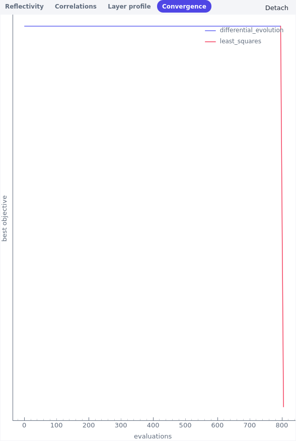
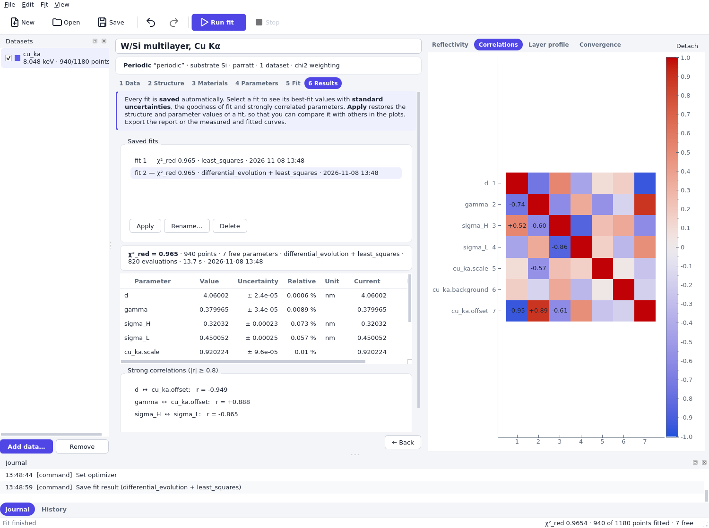

# Uncertainties and checking a fit

A fit returns best values; what they are worth depends on three questions. Is this the best
minimum (not just a local one)? Does the model describe the data? How well do the data determine
each parameter? This page explains how grazing computes the uncertainties and correlations, how to
read them, and how to check a fit. The example snippets fit the Cu Kα measurement of the
[quick starts](../quickstart_fit_library.md) and take about half a minute together.

## How uncertainties are computed

At the best-fit values, grazing computes the Jacobian **J** of the residual vector with respect to
the free parameters by finite differences (a relative step of 10⁻⁵ of each value, one-sided at a
bound). The covariance matrix of the parameters is

> C = s² · (JᵀJ)⁻¹

with s² = 1 for χ² weighting, where the residuals are already divided by the measured
uncertainties, and s² = objective/(points − free parameters) for logarithmic and linear weighting,
where the scatter of the residuals sets the scale. The standard uncertainty of a parameter is the
square root of the corresponding diagonal element, and the correlation matrix follows from C. For
χ² weighting the quantity objective/(points − free parameters) is the reduced χ².

What this means:

- It is the uncertainty of a *linearized* least-squares fit: the data scatter by their uncertainties
  around a model that is right, and the model is linear in the parameters near the minimum.
  Where a parameter hardly changes the curve or the model is strongly nonlinear in it (a roughness
  near zero, for example), the uncertainty is only a rough guide.
- With χ² weighting the uncertainties are as good as the measured uncertainties. If χ²_red is clearly
  above one while the residuals look random, the uncertainties of the data are too small, and the
  parameter uncertainties are too small by about √χ²_red. Multiply them by that factor. If
  the residuals show a trend, the model is wrong, and no uncertainty is meaningful.
- With logarithmic and linear weighting the scale is estimated from the residual scatter, which
  assumes that all points scatter alike. That is a rough assumption for a reflectivity curve, so
  these uncertainties are only indicative.
- The uncertainties are statistical. Systematic effects, such as a wrong photon energy, a wrong
  material density or a model that is too simple, are not included. Fits with tiny uncertainties,
  like the example, only show that the data are very precise.
- The analysis uses the current values; it does not depend on the optimizer. It is only meaningful at a minimum, so
  analyze a fit that has converged.
- Integer parameters (such as the number of bilayers) and parameters with equal bounds are left out.

In Python, {py:func}`~grazing.fit.results.analyze` computes the statistics of a problem, and
every {py:class}`~grazing.fit.results.FitResult` carries them in `statistics`
({py:class}`~grazing.fit.results.FitStatistics`: `names`, `values`, `errors`, `correlation`,
`reduced_objective`, `strong_correlations()`).

## Reading the results

**Relative uncertainty.** The Results page lists the uncertainty also relative to the value. A
period of 4.060 ± 0.00002 nm is determined to 0.0006 %. A parameter whose uncertainty is as large as
its value is not determined by the data. A parameter near a natural limit, such as a roughness near
zero, has a large relative uncertainty by construction.

**Correlations.** The correlation coefficient r between two parameters is between −1 and 1. A
coefficient near ±1 means that the two parameters can compensate each other: a change of one
is almost undone by a change of the other, so their individual uncertainties are large. The report
and the Results page list pairs with |r| ≥ 0.8; the **Correlations** tab shows the whole matrix.
In the example the strongest pairs are

| Pair | r | Why |
|---|---|---|
| period d and angle offset | −0.95 | Both move the Bragg peaks along the angle axis. |
| Γ and angle offset | +0.89 | The offset shifts the peaks, and Γ changes the relative height of the orders. |
| roughness σ_H and σ_L | −0.87 | Both reduce the reflectivity, in particular at high angle. |

What to do about strong correlations: first, note that the uncertainties in the table already include them,
so the values are not wrong, but they are not independent of each other. To quote a result, give
the correlation or the combination that is well determined. If a correlation is a nuisance, fix
one parameter at a value that you know from another source (the offset from an alignment scan), or add
data that separate them (another energy, see
[Fitting several datasets together](fit_simultaneous.md)).

**at bound.** The note *at bound* in the Results page means that the value lies at its minimum or
maximum. The optimizer wanted to go beyond. The bound, and not the data, decided the value, and
the uncertainty is computed one-sided and is not reliable. Widen the bound if the physics permits;
if the value still runs to the edge, the model is missing something, or the parameter does not
matter.

**undetermined.** The note *undetermined* (and in the report `± (undetermined)`) means that no
uncertainty could be computed: the matrix JᵀJ is singular, which means that the data do not
determine all free parameters. This happens if a free parameter has no effect on the curve (a footprint
length when the beam width is zero, a roughness for a fit range far below where it acts, a thickness
of a layer that is invisible) or if parameters are exactly redundant. It also happens if there are
no more points than free parameters. The result shows a warning, and all uncertainties are
`nan`, because one undetermined direction spoils the rest. Fix or remove the parameter that does not act,
and fit again. If the bounds of a parameter are narrower than the finite-difference step, no
uncertainties are computed either and the note explains why.

The section [Parameters that the data do not determine](#parameters-that-the-data-do-not-determine)
shows the case in code.

## Checking a fit

**Reduced χ².** With χ² weighting, χ²_red = χ²/(points − free parameters) should be close to one:
the data deviate from the model as much as their uncertainties say. How close depends on the number
of degrees of freedom: its own uncertainty is √(2/dof), so 0.97 with 933 degrees of freedom, as in
the example, is as good as a fit gets, and 1.2 with 900 degrees of freedom is already significant.

- Much larger than one: the model, or the start values, are wrong, or the uncertainties are too small. Look
  at the residuals.
- Much smaller than one: the uncertainties are too large, or there are too many free parameters
  (the model follows the noise).

**Residuals.** The plot below the curve shows the residuals of the fitted points, (fit − meas.)/σ
for χ², log₁₀(fit/meas.) for the logarithmic and fit − meas. for the linear weighting. For a good fit they
scatter around zero without structure. Typical patterns:

- A slow wave across the range: a wrong period, a wrong offset, or a wrong layer thickness.
- Residuals that grow with angle: a wrong roughness or a wrong model of the roughness.
- A systematic trend in the minima of the fringes: a wrong resolution or background.
- Isolated points far away: outliers that should be excluded.

The numerical counterpart is the normalized residual: its mean should be about zero and its
root mean square about one (see [Fit a measurement with Python](../quickstart_fit_library.md#check-the-fit)).

**Robustness.** Change something that should not matter and see whether the result changes:
the start values, a slightly different fit range, the weighting, or the instrument parameters that
you keep fixed. Parameters that move by much more than their uncertainty are not determined by the
fit alone. Saved fits make such comparisons easy, as shown below.

## Local minima and global search

The reflectivity of a multilayer is an oscillating function of the structure parameters. The
objective has many local minima, and the local least-squares method finds the one nearest to the
start values. The start values must therefore be close to the truth, within about the
spacing of the fringes. Starting the example at a period of 3.6 nm, 11 % too small, ends in a local
minimum with a χ²_red of the order of 10⁵. The start values and the bounds of the example are
a good start for the quick starts, but nothing guarantees it.

A global search explores the whole box between the bounds of all free parameters (differential
evolution with an initial population spread over the box), followed by a local
refinement from its best point. It needs finite bounds, so the choice of the bounds is part of the
search: narrower bounds from prior knowledge make it much more efficient. The snippet starts
with the failed local fit and then runs a global search with a small budget (a production fit
uses more evaluations, the default of `grazing-fit` is 4000, and several seeds):

```python
from grazing.core.io import CsvLayout, read_curves
from grazing.core.materials import get
from grazing.core.optim import LmfitOptimizer
from grazing.core.parameters import free
from grazing.core.structure import Mirror, Periodic
from grazing.core.units import deg
from grazing.fit.dataset import Dataset
from grazing.fit.project import (
    FitProject,
    add_dataset,
    run_fit,
    set_mirror,
    set_optimizers,
    set_parameter,
    set_weighting,
    store_result,
)

layout = CsvLayout(
    x_column="2theta_deg",
    reflectivity_column="R",
    uncertainty_column="dR",
    quantity="two_theta",
    energy=8048.0,
)
(curve,) = read_curves("examples/data/WSi_multilayer_cu_ka.csv", layout)
mirror = Mirror(
    Periodic.create(
        get("W"),
        get("Si"),
        N=20,
        d=free(3.6, 3.0, 6.0),  # a poor start value and wide bounds
        gamma=free(0.4, 0.25, 0.55),
        sigma_H=free(0.3, 0.0, 0.8),
        sigma_L=free(0.3, 0.0, 0.8),
    ),
    substrate=get("Si"),
)
dataset = Dataset.create(
    "cu_ka",
    curve,
    scale=free(1.0, 0.5, 1.5),
    background=free(1e-7, 0.0, 1e-5),
    offset=free(0.0, -deg(0.02), deg(0.02)),
    resolution=deg(0.004),
    beam_width=0.05e6,
    sample_length=20e6,
).with_ranges([(deg(0.35), deg(1.6)), (deg(1.8), deg(3.0))], excluded=[(deg(2.05), deg(2.15))])

project = FitProject()
project.execute(set_mirror(mirror))
project.execute(add_dataset(dataset))
project.execute(set_weighting("chi2"))

local = run_fit(project.state)
project.execute(store_result(local, name="local from 3.6 nm"))
print(f"local fit: chi2_red = {local.statistics.reduced_objective:.3g}")

# Prior knowledge narrows the period; then search globally and refine locally.
project.execute(set_parameter("d", min=3.5, max=4.6))
stages = [
    LmfitOptimizer(
        "differential_evolution",
        max_evaluations=800,
        options=(("seed", 0), ("popsize", 8), ("polish", False)),
    ),
    LmfitOptimizer("least_squares"),
]
project.execute(set_optimizers(stages))
best = run_fit(project.state)
project.execute(store_result(best, name="global search"))
print(f"global search + refinement: chi2_red = {best.statistics.reduced_objective:.3g}")
```

The convergence plot of `grazing-fit` (tab **Convergence**) shows the best objective of each stage
against the evaluations: the global stage lowers the objective step by step as the population
finds better regions, and the local stage then falls quickly into the minimum.



A single global search is not a proof. The population is random, so check the result with another
`seed` and with a larger `popsize` or evaluation limit: if the best objective does not improve, the
minimum is probably the global one. Be aware that the fit has no information on structures
outside your bounds, and that a very different structure with a similar curve (the same period,
a different Γ) can exist for data of a limited range.

## Comparing saved fits

Every fit is saved in the project: in `grazing-fit` on the Results page, in Python in
`project.state.results` (a tuple of {py:class}`~grazing.fit.project.StoredFit`, with the name, the result,
the structure with the fitted values, the model and notes). Saved fits make it cheap to compare
alternatives: other weightings, other ranges, other start values, a parameter fixed or free. In
`grazing-fit` select a fit to see its table; *Apply* restores its structure and parameter values in
the project, so the plot shows it and the next fit starts from it. Rename a fit to say what it
is (Rename…, F2 or double-click).



The first saved fit above ended in a local minimum and the second, after a global search with narrower
bounds, found the minimum with χ²_red of one. The first is kept so that the comparison stays visible.

```python
for stored in project.state.results:
    stats = stored.result.statistics
    print(
        f"{stored.name:20s} {stored.result.method:36s} "
        f"d = {stored.result.parameters['d'].value:.4f} nm  chi2_red = {stats.reduced_objective:.3g}"
    )
```

Comparing the numbers makes sense under conditions:

- The χ²_red of fits are comparable if they use the same data, ranges and weighting. Different ranges
  or weightings change the number of points and the meaning of the objective.
- A smaller χ² with more free parameters is not yet evidence for the more complex model. Compare
  the reduced values, check that the additional parameters are determined (not *undetermined*, not
  *at bound*, not strongly correlated) and that the residuals improve.
- Differences between parameter values that are small compared with their uncertainties are not
  meaningful.

## Parameters that the data do not determine

The `analyze` function can show the *undetermined* case directly. The sample length has no effect
once the beam width is zero (no footprint), so freeing it makes the matrix JᵀJ singular:

```python
import math

from grazing.fit.results import analyze

fitted = project.state.problem()  # the best values of the global search are applied
parameters = fitted.parameters.replace("cu_ka.beam_width", value=0.0).replace(
    "cu_ka.sample_length", vary=True, min=1e6, max=5e7
)
statistics = analyze(fitted.with_parameters(parameters))
print("determined:", statistics.determined)
print("uncertainty of the period:", statistics.error("d"))
assert math.isnan(statistics.error("d"))
```

The uncertainties of all parameters are `nan`: that is how the statistics flag that at least one
direction of the parameter space is not constrained, and the parameter responsible (here
`cu_ka.sample_length`) has to be fixed.
